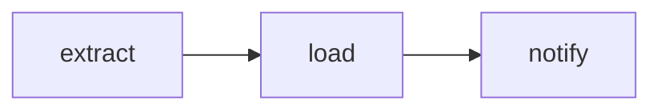

# A first DAG

`examples/sync.py` is a complete DAG: two Python tasks and a shell command, scheduled for
03:00 in Warsaw. Python 3.14 or newer is required (a command can use a t-string, `t"..."`).

```{literalinclude} ../../examples/sync.py
:language: python
:caption: examples/sync.py
```

`with Dag(...)` defines one DAG. The string is its ID. Everything created in the block
belongs to it, and the block records the DAG when it ends. Calling `extract()` here does
not run `extract`: it records a task and returns an `Output`, a reference to the value the
task will produce. `load(rows)` records a second task that receives that value, so `load`
runs after `extract`. The command is a third task; `{count}` and
`{dag_ctx.run.planned_for}` are filled in when the run reaches it.



`trigger` is the schedule. `defaults` apply to every task in the block; `load` replaces the
timeout for itself. The other pages cover [tasks](02-tasks.md), [data flow](03-data-flow.md),
[schedules](04-schedules.md), [defaults](05-defaults.md), the
[DAG context](06-context.md) and [routing by outcome](08-outcomes.md).

Check the file, then run it locally. Neither command needs a server:

```
schedr dags check examples/sync.py
schedr dags test sync_customers --path examples/sync.py --for 2026-10-15T01:00Z
```

`dags check` imports the file and prints one line per file. It starts a new process; a
worker's parse job can be forked instead. `dags test` runs one real run, each task in its
own process, and prints the logs and a table.
[Testing a DAG](07-testing.md) is both commands, and how a pytest does the same thing.
[Life of a run](../03-guide/03-life-of-a-run.md) is what that run does inside schedr.

## A file and its DAGs

| The file | What an import does |
|---|---|
| One `with Dag(...)` | Records that DAG |
| Several `with Dag(...)` blocks, one after another | Records each of them. [Schedules](04-schedules.md) is a file of five. |
| No `with Dag(...)` | Records nothing. `schedr dags check` prints `ok     helpers.py: no DAGs`. A `@task` function defined here can be called inside another file's `with Dag(...)`. |
| `with Dag(...)` inside another `with Dag(...)` | `RuntimeError`: `` `with Dag('inner')` inside `with Dag('outer')`: DAGs can't be nested `` |

A DAG ID is explicit. It is up to 250 bytes: ASCII letters, digits and `_ . - : / #`. The
same ID in two files of the newest code is a conflict, and schedr creates no runs until
that is resolved ([Parsing and code versions](../03-guide/06-parsing.md)).

A new DAG is stored paused. `schedr dags unpause <id>` lets the scheduler create its runs
([Schedules](04-schedules.md#pausing)).
