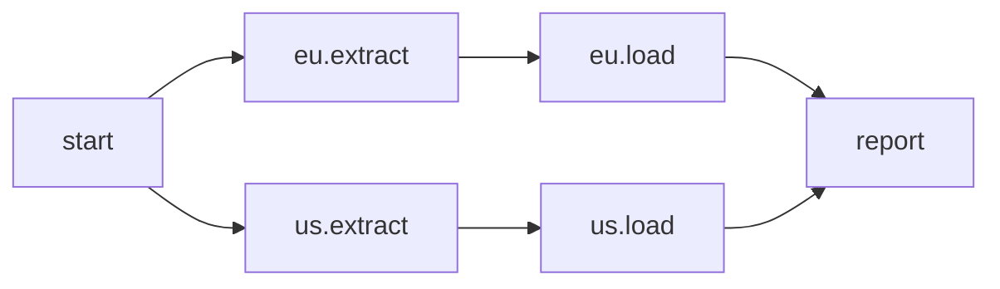

# Task groups

A group organises tasks while the DAG is written. It does not run, and it has no state of
its own. Its tasks become ordinary tasks with a prefixed ID, and a dependency on the group
becomes ordinary edges. The master schedules those tasks and edges. It only checks the
groups.

```{literalinclude} ../../examples/docs/groups.py
:language: python
:caption: examples/docs/groups.py
```

`extract`, `load` and `report` are each defined once. The loop builds one group per source,
so the same functions run twice and their IDs don't collide: `eu.extract`, `eu.load`,
`us.extract`, `us.load`. No `.override()` is needed. `start` and `report` are outside the
groups, so their IDs have no prefix. `defaults` on the group gives `extract` and `load` two
retries, 30 seconds apart; `start` and `report` keep the built-in defaults.
`start >> per_source` runs `start` before each group's first task, `eu.extract` and
`us.extract`. `report` takes the two `load` outputs, so it waits for both.



## Writing a group

```python
with group("load", defaults=TaskDefaults(retries=2), run_if=RunIf.ALL_SUCCEEDED) as load:
    transformed = transform(extract())
```

`group` is `schedr.group`, a `Group`. The name is one ID part, so a `.` in it is an
`IdError`; the qualified ID follows the [task ID](02-tasks.md#ids) rules. A group opened
inside another is nested. `with group("eu"):` inside `load` gives `load.eu.extract`, and
`load.eu`'s parent is `load`. The same name in a different parent is a different group
(`x` inside `x` is `x.x`). A name used twice in one parent, or a name that is already a
task's ID, is an `IdError`. So is a task whose ID is already a group's.

`defaults` and `run_if` apply to the tasks created in the block, for the fields they set.
An inner group's value wins over an outer group's for that field; a field the inner group
leaves unset keeps the outer group's, then the DAG's `defaults`, then the built-in one. A
task's own arguments win over all of them. `run_if` on a group is only that default. The
group is never waited on or skipped: its tasks are.

`with group(...)` belongs inside `with Dag(...)`. A group's block that raises is still
closed when the DAG file catches the error: tasks created after the block are not in the
group, and a dependency on the group still sees the tasks created before the error.

## A dependency on a group

`>>`, `<<` and `chain` take a group. The dependency is made when the `with Dag` block
ends, from every edge of the DAG, including edges written after the group's own block. Where
the statement sits does not change which tasks it joins. A mistake is reported then, as the
block ends, and the message starts with the file and line of the `>>`, `<<` or `chain` that
wrote it.

| What you write | The edges |
|---|---|
| `start >> load` | `start` runs before each of the group's **first** tasks: a task in the group with no upstream task inside it |
| `load >> publish` | `publish` runs after each of the group's **last** tasks: a task in the group with no downstream task inside it |
| `load << start` | The same as `start >> load` |

With `a >> b` and a task `c` that nothing inside the group connects, `start >> load` gives
`start >> a` and `start >> c`, and `load >> publish` gives `b >> publish` and
`c >> publish`. Those are ordinary edges, so a skip flows along the group's own chain: a
skipped `a` skips `b`, and `b` does not also hang on `start`. A data edge inside the group
(`transform(extract())`) counts the same way. An edge written after the block counts too:
`fetched.on(Rows) >> store` inside the group means `store` is not a first task, so
`start >> load` does not run `store` on its own.

An empty group, or a group whose tasks form a cycle, has no first or last task. Depending
on it is a `ValueError` when the block ends. An empty group says
`` sync.py:42: `>>`: group `empty` has no tasks, so nothing can depend on it ``.
A cycle names the tasks, `` sync.py:42: group `g`'s tasks form a cycle: g.a -> g.b -> g.a, so none is its last ``.
Two group dependencies that each need the other's edges first are refused the same way;
the message names each dependency with its location:
`` dependencies on groups each need the other's edges first (`>>` at sync.py:10, `<<` at sync.py:11): write the tasks' own dependencies instead ``.
A dependency that would make a task depend on itself is a `ValueError`, as for any edge.

## A group that ends with a `@branch`

A dependency on a group joins the group's last tasks to what comes after it with plain
order edges, and a `@branch` among those last tasks is included. The edge is taken once
the branch has run, whatever it chose. The branch's own edges stay choices.

```python
@branch
def pick() -> list[Task]:
    return [yes]

with group("route") as route:
    chosen = pick()

yes, no = EmptyOperator("yes"), EmptyOperator("no")
chosen >> [yes, no]             # selection edges: taken when pick chose that task
route >> EmptyOperator("then")  # a plain order edge from route.pick
```

`yes` and `no` run when `pick` chose them. `then` runs when `pick` has succeeded, including
when `pick` returned `[]` and both of the others were skipped. With `RunIf.NONE_FAILED`
(the default) a task after the group runs unless one of the group's last tasks failed or
every one of them was skipped. With `RunIf.ALL_SUCCEEDED` it runs only when every one of
them succeeded. The master accepts that order edge from a `@branch` to a task outside the
branch's group. Every other edge leaving a `@branch` is a selection edge.

## On the run graph

The run page draws a box around each group's tasks, labelled with the group's own name. A
nested group's box sits inside its parent's, and the gap between layers grows with the
nesting. Hovering the box shows the full group id. The tasks and the edges are the ordinary
ones: the box is how the graph is drawn, and the group still has nothing of its own to run.
[The web UI](../03-guide/12-ui.md#the-graph) is the rest of the graph.
