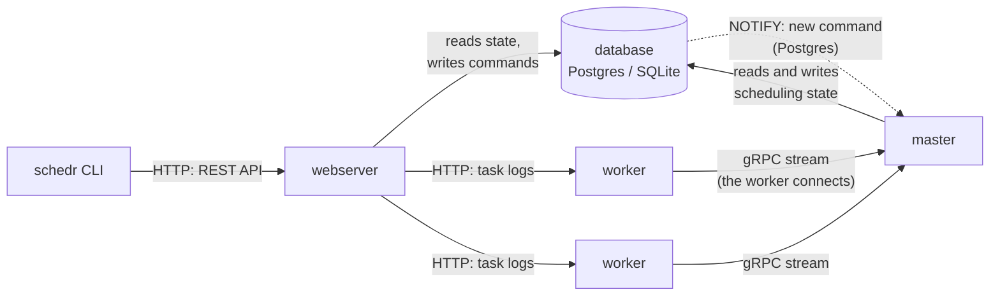

# Overview

schedr is one binary, `schedr`, that runs in one of four **roles**. In a cluster each role
runs in its own pods; on a laptop `schedr standalone` runs them all in one process.

| Role | What it does | Runs user code? | State |
|---|---|---|---|
| `schedr master` | Decides everything: when runs start, which worker runs which task, what a failure means. Its scheduling loop works in [rounds](04-master.md). | Never | Reads and writes the database |
| `schedr worker` | A Rust agent that runs tasks and parses DAG files, each in a Python or shell subprocess. Keeps task logs on its disk. | Yes, in subprocesses | A journal on its own disk; no database |
| `schedr webserver` | The REST API that the CLI uses (later the web UI). Reads state from the database; turns actions into **commands** for the master. | Never | Reads the database, writes only commands |
| `schedr standalone` | All three in one process, on localhost, with SQLite by default. For a laptop, or one pod to try schedr on a cluster. | Yes | SQLite file in the data directory |

## How the parts talk

- **The database is the only shared state.** The master and the webserver never call each
  other: the webserver writes a command row, and the master picks it up, applies it and
  records its decision. So the API keeps answering while the master restarts, and an action
  sent meanwhile is applied when the master is back.
- **Workers always open the connection to the master**, never the other way round. Each keeps
  one long-lived gRPC stream; the master sends work and cancels over it at once.
- **The webserver reads task logs from the worker that ran the task**: logs stay on the
  worker's disk, and the webserver passes them on. Clients never reach workers.
- **The master is the only writer of scheduling state.** The webserver writes command rows
  only, and workers write nothing to the database.

## Ports

| Port | Role | Default | Who connects |
|---|---|---|---|
| REST API | webserver | 8080 | the CLI, users |
| gRPC | master | 8070 | workers |
| Log endpoint | worker | 8081 | the webserver |
| Ops (`/healthz`, `/readyz`, `/metrics`) | every role | 8090 | kubelet probes, Prometheus |

The gRPC port and the log endpoint use mTLS unless a service mesh provides it (see
[Network and security](08-network.md)). The ops port is plain HTTP and serves no data (see
[Observability](09-observability.md)).

## Where to go next

- [Writing DAGs](../02-dags/index.md) is how to define the tasks this system runs.
- [Life of a run](03-life-of-a-run.md) follows one run through every part.
- [The master](04-master.md) explains the scheduling loop and its rounds.
- [Workers](05-workers.md) covers what a worker does with a task, and how it survives restarts.
- [State and failures](07-failures.md) says what happens when any part stops.
