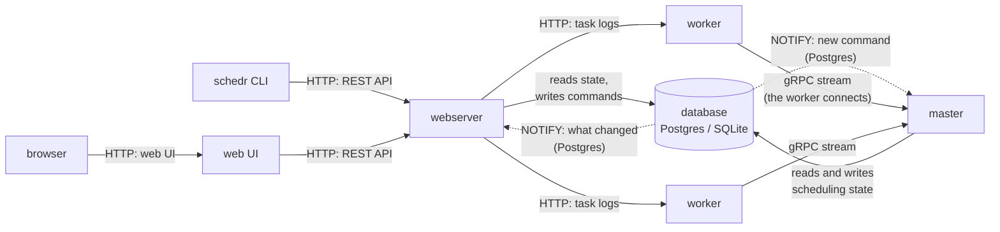

# Overview

schedr is one binary, `schedr`, that runs in one of five **roles**. On a laptop `schedr
standalone` runs them all in one process and serves the web UI on the REST API's port. The
chart's standalone mode does the same in one pod. Its distributed mode runs the master, the
webserver and the workers in their own pods. A `schedr ui` pod comes with M3.6; until then
that role is run on its own (see [Deployment](10-deployment.md#running-schedr-ui)).

| Role | What it does | Runs user code? | State |
|---|---|---|---|
| `schedr master` | Decides everything: when runs start, which worker runs which task, what a failure means. Its scheduling loop works in [rounds](04-master.md). | Never | Reads and writes the database |
| `schedr worker` | A Rust agent that runs tasks and parses DAG files, each in a Python or shell subprocess. Keeps task logs on its disk. | Yes, in subprocesses | A journal on its own disk; no database |
| `schedr webserver` | The REST API that the CLI and the web UI use. Reads state from the database and follows what changed, for the UI's live pages; turns actions into **commands** for the master. | Never | Reads the database, writes only commands |
| `schedr ui` | The web UI over one or more deployments' webservers. Talks only to their REST APIs. See [The web UI](12-ui.md). | Never | None of its own |
| `schedr standalone` | All of the above in one process (SQLite or Postgres): local development, or one pod in production. Serves the web UI at `/` on the REST API's port; its deployment is named `default`. | Yes | SQLite file in the data directory, or Postgres |

## How the parts talk

- **The database is the only shared state.** The master and the webserver never call each
  other: the webserver writes a command row, and the master picks it up, applies it and
  records its decision. So the API keeps answering while the master restarts, and an action
  sent meanwhile is applied when the master is back.
- **The web UI talks only to webservers**, one per deployment (one is the common case). In
  `schedr standalone` that call stays inside the process, and the browser uses the REST API's
  port. The UI never reaches the master, the workers or the database.
- **The webserver follows what each write changed**, and the UI's pages update from that.
  The writes announce what changed, on by default. On Postgres the webserver is notified
  when the writing transaction commits. On SQLite it reads a table of changes. Otherwise the
  pages refresh on a timer. See [Live updates](12-ui.md#live-updates).
- **Workers always open the connection to the master**, never the other way round. Each keeps
  one long-lived gRPC stream; the master sends work and cancels over it at once.
- **The webserver reads task logs from the worker that ran the task**: logs stay on the
  worker's disk, and the webserver passes them on. Clients never reach workers.
- **The master is the only writer of scheduling state.** The webserver writes command rows
  only, and workers write nothing to the database.

## Ports

| Port | Role | Default | Who connects |
|---|---|---|---|
| REST API | webserver, and standalone | 8080 | the CLI, `schedr ui`; browsers too, when standalone serves the UI on this port |
| Web UI | `schedr ui` | 8082 | browsers |
| gRPC | master | 8070 | workers |
| Log endpoint | worker | 8081 | the webserver |
| Ops (`/healthz`, `/readyz`, `/metrics`) | every role | 8090 | kubelet probes, Prometheus |

`schedr standalone` serves the web UI on the REST API's port: 127.0.0.1, or the address
passed to `--listen`, on 8080. `schedr ui` uses 8082. The gRPC port and the log endpoint use
mTLS unless a service mesh provides it (see [Network and security](08-network.md)). The REST
API, the web UI and the ops port are plain HTTP. The ops port serves no data (see
[Observability](09-observability.md)).

## Where to go next

- [Writing DAGs](../02-dags/index.md) is how to define the tasks this system runs.
- [The web UI](12-ui.md) is the pages and how they update, the themes, the times and `/docs`.
- [Life of a run](03-life-of-a-run.md) follows one run through every part.
- [The master](04-master.md) explains the scheduling loop and its rounds.
- [Workers](05-workers.md) covers what a worker does with a task, and how it survives restarts.
- [State and failures](07-failures.md) says what happens when any part stops.
