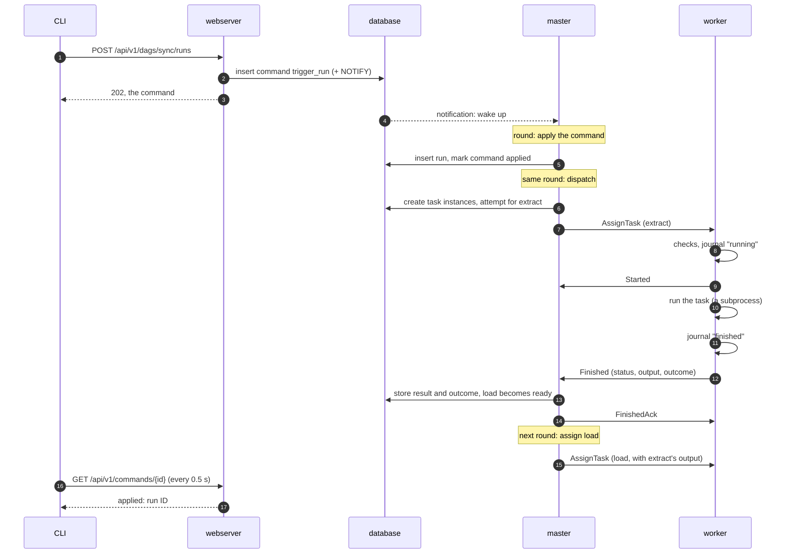

# Life of a run

This page follows one manual run of a two-task DAG `sync` (`extract` → `load`) from the CLI to
its result. A scheduled run goes the same way, except that the scheduler creates it in step 3
instead of a command.

## 1. The request becomes a command

`schedr runs trigger sync` calls the webserver's REST API. The webserver checks nothing about
scheduling. It stores a `trigger_run` command row and answers `202` with the command. On
Postgres the insert also sends a notification on a channel the master listens to.

The CLI then reads the command back every 0.5 s, for up to 30 s, until the master has decided.

## 2. The master wakes up

The master's loop runs a [round](04-master.md) every `[master] tick_interval` (1 s), and at
once when a notification arrives. On SQLite there are no notifications, so the command waits
for the next round.

## 3. The round applies the command

The round's first step applies every pending command, oldest first. For `trigger_run` the
scheduler checks that the DAG can run, then inserts a run. The run is `running` if the DAG is
under `max_active_runs`, otherwise `queued`. The command is then marked `applied`, with the run
ID as its result. A command that can't apply (an unknown DAG, a time in the future, or a DAG
whose file fails to import) is marked `rejected` with the reason, and the CLI prints it and
exits 1.

A DAG whose file fails to import, other than a timeout or a runner that died, is held. The
scheduler creates no run of it, a fire time during the hold is missed as while it is paused,
and a queued run is not started. A run that has already started is not cancelled. A timeout
or a runner that died holds nothing: the file is parsed again.
[Parsing](06-parsing.md#a-held-dag) is the whole of it.

## 4. The same round dispatches

Later in the same round the dispatcher:

1. creates one row per task, at `map_index` -1: `extract` has no upstream task, so it is
   `queued`; `load` is `scheduled`. A mapped task's instances are created when it expands
   ([A mapped task](#a-mapped-task));
2. picks a worker for `extract`: among `active` workers that serve its queue, run a recent
   enough schedr and have a free slot, the one with the most free slots. Workers that
   reported the root's current code come first; one that said it lacks the code is picked
   only when no other can take the task (it may have synced since, else it rejects again);
3. stores the attempt in the database **before** sending anything, then builds `AssignTask`:
   attempt ID, what to run, the expected code hash, the inputs, timeouts and memory budget.

When the round ends, the master sends the round's messages down the workers' streams.

## 5. The worker accepts and runs it

The agent checks the assignment: it has a free slot, it isn't draining, the file and the
interpreter are there, and its code is at the expected hash. If a check fails it sends
`Rejected` with a reason, and the master tries elsewhere or waits.

If the checks pass, it records the attempt as running in its journal on disk, then sends
`Started`. A `Started` that doesn't arrive within 10 s makes the master take the assignment
back (`assignment_expired`) and queue the task again, without using a retry; one that arrived
in time counts even if a busy master handles it later.

The agent starts a Python runner in a new process group, with stdout and stderr going to the
attempt's log file. The runner says `hello`. The agent sends the task. Once the DAG file is
imported and the arguments are built, the runner sends `task_imported` (no fields) and calls
the function; it does not send that message when the import or the arguments fail. The agent
times both gaps on its own clock (`schedr_worker_task_start_seconds`, see
[Observability](09-observability.md)). The result comes back over the same local socket.
The memory watchdog samples the group's memory every second. With `fork_server = true` on
the DAG interpreter, a Linux worker starts that Python runner from a fork server (see
[The fork server](05-workers.md#the-fork-server)), and the attempts API shows `start_method`
`fork`. A task with `preload` false asks only the bare server. A task with `fresh_process`
true, and a task those servers can't fork, is a new process (`spawn`). A forked task the
worker drops before it has ended is killed, as a spawned one is. A forked task whose PSS
can't be read is not killed on resident set size, because that size includes the pages it
shares with the fork server.

## 6. The result comes back

The agent records the result in its journal, then sends `Finished`: the status, the output,
the outcome (on success), the duration, the peak memory, `usage` and `core_dumped`. The
master handles it as soon as it arrives, between rounds:

- it stores the attempt's result and the task's new state (`success`, or `up_for_retry` /
  `failed` by the retry rules);
- on success it stores the output with its outcome (the name the worker reported, or
  `SUCCESS` when the worker named none);
- it moves the run forward: each downstream task is decided by its incoming edges and
  `run_if`, as soon as that result is certain, so `load` becomes `queued`;
- it answers `FinishedAck`, and the agent deletes the journal file.

Delivery is at least once. A worker that doesn't get the acknowledgement sends `Finished`
again, and the master acknowledges the repeat without storing it twice.

## 7. The next task, and the end

The next round assigns `load`. Its `AssignTask` carries `extract`'s output as input, and
the outcomes of the upstream tasks `load` uses (`""` for a skipped one). A task whose
edges and `run_if` are already decided is skipped or `upstream_failed` without being
assigned: an edge not taken (`.on(...)` whose outcome didn't happen, a `@branch` that
didn't choose that target, or a skipped upstream task) counts as skipped;
`RunIf.NONE_FAILED` (the default) still runs when another edge succeeded, and
`RunIf.ALL_SUCCEEDED` skips. A failure on any edge makes the task `upstream_failed` as
soon as that failure is known. [The master](04-master.md#when-a-task-is-ready) is the
rule; [Routing by outcome](../02-dags/08-outcomes.md) is how a DAG declares it.

When every task instance has a final state, the run gets its result: `failed` if a task
failed after its last retry, `cancelled` if a user cancelled it and nothing failed,
otherwise `success`. A skipped task leaves the run `success`. `upstream_failed` is a
consequence of the original failure, which already makes the run `failed`. Independent
parts of the graph keep running after a failure.

Meanwhile `schedr tasks logs` reads each attempt's log through the webserver, which fetches
it from the worker that ran the attempt (see [Workers](05-workers.md)). The
[run page](12-ui.md#a-run) shows that run: its state, its graph, its tasks, a task's
attempts, output and log, and the commands about it.

## A mapped task

The walkthrough's tasks are not mapped. Every task, mapped or not, gets one row at the
start of the run, `map_index` -1, `scheduled`. An unmapped task's row is the one the master
assigns, and it is that task's only row. A mapped task's `-1` row is never sent to a
worker. It stays `scheduled` until the task expands. With instances it becomes
`running`, and then takes the state those instances settle to. When it cannot expand it
becomes `failed`. The instances are further rows, `0` to `N-1`, created when it expands.
The API lists the `-1` row first and then
those instances. `?map_index=-1` means the same as leaving the index off
([Mapping](../02-dags/10-mapping.md#following-the-instances)).

When the task's edges are ready, the master expands it and stores the instances in the same
transaction as the `-1` row's new state. One instance per element, numbered from 0. An empty
list ends the task `success`, with output `[]` and no instances. The task fails, with a
reason and with nothing run, when what it maps over is not a list, when an
`.expand_kwargs()` list it waits for as a whole has an element that is not a dict, or when
it would have more than `[mapping] max_instances` instances (1024). On a lane, an
`.expand_kwargs()` element that is not a dict fails that instance when it is assigned, as
`input_mismatch`, which is not retried.

A lane is an element-wise data edge: the task is mapped over the whole output of a mapped
task, and it uses that task nowhere else. A lane counts as ready once that upstream task
has expanded, so the downstream task can expand before those instances finish, and instance
`i` then waits only for upstream instance `i`. Any other edge waits for the upstream task
as a whole: an order edge, `.partial(all=…)`, or `results[0]`. If that upstream task
failed, nothing of the downstream
task runs.

One failed instance, or a lane whose upstream instance failed, fails the mapped task at
once. The task is `failed` when one of its own instances failed, and `upstream_failed` when
the only failures are lanes. Instances that have not started are cancelled. Ones that are
running are stopped. A result that arrives after the `-1` row is already final does not
change that row. The attempt is recorded as the worker reported it, the instance ends
`cancelled` whatever that report was, and its output is not stored. Instances that had
already succeeded keep their results. The tasks after a failed mapped task are
`upstream_failed`.

When every instance has finished and none failed, the task's `run_if` applies to the
instances. `NONE_FAILED` (the default) succeeds unless every instance was skipped.
`ALL_SUCCEEDED` skips the task if any instance was skipped. Any `cancelled` instance makes
the whole task `cancelled`. A failure is decided first, so it wins over a cancellation.
The list a downstream task reads is built then, in `map_index` order, from the instances.
It is not stored on the `-1` row. An instance that did not succeed is JSON null in that
list, which the next task reads as `None`.
[Mapping](../02-dags/10-mapping.md) is how a DAG writes this.
