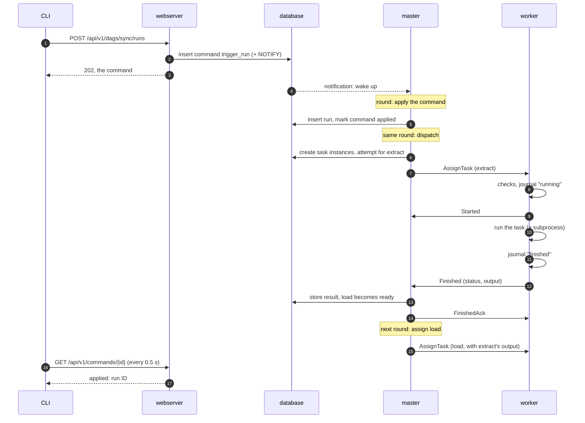

# Life of a run

This page follows one manual run of a two-task DAG `sync` (`extract` → `load`) from the CLI to
its result. A scheduled run goes the same way, except that the scheduler creates it in step 3
instead of a command.

## 1. The request becomes a command

`schedr runs trigger sync` calls the webserver's REST API. The webserver checks nothing about
scheduling. It stores a `trigger_run` command row and answers `202` with the command. On
Postgres the insert also sends a notification on a channel the master listens to.

The CLI then reads the command back every 0.5 s, for up to 30 s, until the master has decided.

## 2. The master wakes up

The master's loop runs a [round](04-master.md) every `[master] tick_interval` (1 s), and at
once when a notification arrives. On SQLite there are no notifications, so the command waits
for the next round.

## 3. The round applies the command

The round's first step applies every pending command, oldest first. For `trigger_run` the
scheduler checks that the DAG can run, then inserts a run. The run is `running` if the DAG is
under `max_active_runs`, otherwise `queued`. The command is then marked `applied`, with the run
ID as its result. A command that can't apply (an unknown DAG, a time in the future) is marked
`rejected` with the reason, and the CLI prints it and exits 1.

## 4. The same round dispatches

Later in the same round the dispatcher:

1. creates the run's task instances: `extract` has no upstream task, so it is `queued`; `load`
   is `scheduled`;
2. picks a worker for `extract`: among `active` workers that serve its queue, run a recent
   enough schedr and have a free slot, the one with the most free slots. Workers that
   reported the root's current code come first; one that said it lacks the code is picked
   only when no other can take the task (it may have synced since, else it rejects again);
3. stores the attempt in the database **before** sending anything, then builds `AssignTask`:
   attempt ID, what to run, the expected code hash, the inputs, timeouts and memory budget.

When the round ends, the master sends the round's messages down the workers' streams.

## 5. The worker accepts and runs it

The agent checks the assignment: it has a free slot, it isn't draining, the file and the
interpreter are there, and its code is at the expected hash. If a check fails it sends
`Rejected` with a reason, and the master tries elsewhere or waits.

If the checks pass, it records the attempt as running in its journal on disk, then sends
`Started`. A `Started` that doesn't arrive within 10 s makes the master take the assignment
back (`assignment_expired`) and queue the task again, without using a retry; one that arrived
in time counts even if a busy master handles it later.

The agent starts a Python runner in a new process group, with stdout and stderr going to the
attempt's log file. The runner says `hello`. The agent sends the task. Once the DAG file is
imported and the arguments are built, the runner sends `task_imported` (no fields) and calls
the function; it does not send that message when the import or the arguments fail. The agent
times both gaps on its own clock (`schedr_worker_task_start_seconds`, see
[Observability](09-observability.md)). The result comes back over the same local socket.
The memory watchdog samples the group's memory every second. With `fork_server = true` on
the DAG interpreter, a Linux worker starts that Python runner from a fork server (see
[The fork server](05-workers.md#the-fork-server)), and the attempts API shows `start_method`
`fork`. A task with `preload` false asks only the bare server. A task with `fresh_process`
true, and a task those servers can't fork, is a new process (`spawn`). A forked task the
worker drops before it has ended is killed, as a spawned one is. A forked task whose PSS
can't be read is not killed on resident set size, because that size includes the pages it
shares with the fork server.

## 6. The result comes back

The agent records the result in its journal, then sends `Finished`: the status, the output,
the duration, the peak memory, `usage` and `core_dumped`. The master handles it as soon as it
arrives, between rounds:

- it stores the attempt's result and the task's new state (`success`, or `up_for_retry` /
  `failed` by the retry rules);
- it moves the run forward: `load`'s upstream condition is met, so `load` becomes `queued`;
- it answers `FinishedAck`, and the agent deletes the journal file.

Delivery is at least once. A worker that doesn't get the acknowledgement sends `Finished`
again, and the master acknowledges the repeat without storing it twice.

## 7. The next task, and the end

The next round assigns `load`. Its `AssignTask` carries `extract`'s output as input. When
every task instance has a final state, the run gets its result: `failed` if a task failed
after its last retry, `cancelled` if a user cancelled it and nothing failed, otherwise
`success`.

Meanwhile `schedr tasks logs` reads each attempt's log through the webserver, which fetches
it from the worker that ran the attempt (see [Workers](05-workers.md)).
