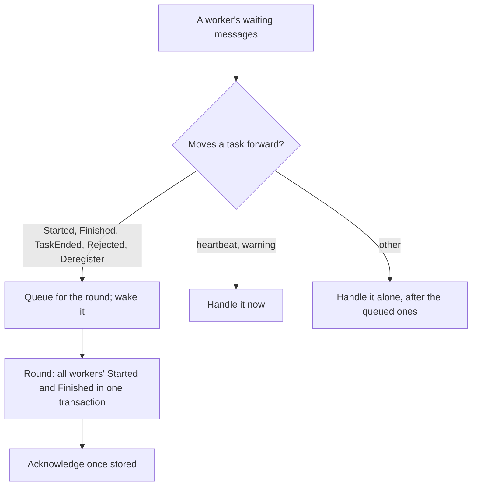
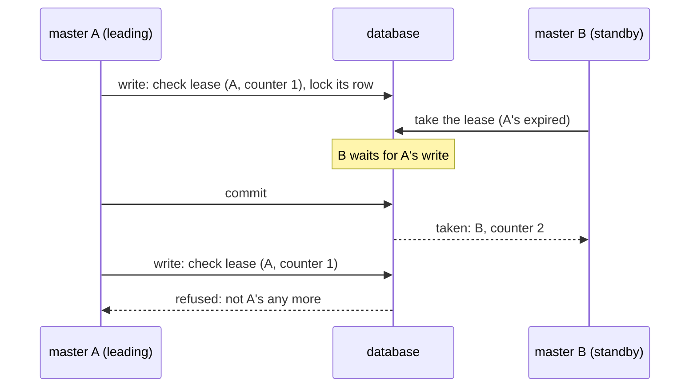

# The master

The master makes the scheduling decisions. It holds an in-memory view of the
workers (who is connected, their slots, queues and code) and keeps everything else in the
database. One master leads per database (below); when it restarts, it reads its state
back from the database.

Scheduling and worker messages share **one lock**, taken for one piece of work at a time: each part of a
round (below), and each transaction of a worker's messages. Each piece sees a consistent view
and two never interleave; between them the lock goes to whoever waited first, so a worker's
`Started` doesn't wait for a whole round, nor a round for another worker's whole turn
(decisions 469, 480).

## Rounds

The scheduling loop runs a **round** (a "tick" in the code and the metrics) every [second](14-timings.md#fixed-timings). On Postgres it also runs one as soon as a new command is
announced. Every notification that has arrived by then is taken by that one round, so a
burst of commands costs one round, not one each. The 1 s timer starts again after a round
woken this way.

A worker's `Finished` also wakes a round, on SQLite and Postgres alike. Its downstream tasks
are then ready and dispatched at once, not at the next tick, which spared a chain of tasks
up to a second on each step. A round woken this way starts at least 50 ms after the previous
round ended. An idle master runs it at once. Under a stream of finishes it runs at most 20
rounds a second, and each round takes every finish that arrived meanwhile. That leaves the
lease's renewals and the workers' messages their turns. Other messages (a `Started`, a
heartbeat, a new worker registering) wait for the next tick.

**Notifications behind a connection pooler.** The master listens (Postgres `LISTEN`) on a
connection of its own. A pooler in **transaction** mode (PgBouncer and similar) can't carry
that: it lends the server connection the master listens on to other clients, whose queries
then fail on notifications they didn't expect. So before listening, the master checks the
connection it would listen through, from inside its own database (no other rights needed):
it reads the Postgres process behind one connection, opens a transaction on a second one, and
reads the first's again. A second client on the first one's process, or the first moved to
another process, means a pooler in transaction mode; the check repeats five times. Found, the
master warns and doesn't listen: new commands then wait for its next round (up to 1 s). For
immediate commands behind such a pooler, `[database] notifications_url` gives the master a
connection straight to Postgres for listening only (checked the same way);
`[database] notifications = false` turns notifications off, and the warning with them. A
database error that shows a notification where an answer was expected says that a pooler is
the likely cause.

The webserver listens the same way, for the UI's live pages (see
[Live updates](12-ui.md#live-updates)). It uses the same check and the same
`[database] notifications_url`. When notifications are off, or the check finds a pooler in
transaction mode, the webserver logs `the database's changes can't be followed (notifications
off, or a pooler in transaction mode): live pages refresh every 15 s` and those pages get
`refresh` on that timer instead of hearing each change. The number of seconds is
the [refresh interval](14-timings.md#fixed-timings) (15 s by default, at least 1 s). `[database]
change_notifications = false` turns the change triggers off, and the pages refresh on that
same timer. On SQLite neither side listens. The master's commands wait for the next round.
The writes append a row to `changes`, and the webserver reads the new rows every second, so
the pages still follow each change while those triggers are on.

A round limits each kind of work so a backlog leaves room for worker messages and lease
renewals. With the default limits, it works through these stages:

1. **Commands.** Apply up to 50 pending commands, oldest first. Each command and its decision
   (`applied` or `rejected`) use one transaction and one turn under the lock. A failed
   transaction leaves the command pending and sends nothing. Drains move parse jobs to other
   workers; resumes allow parse jobs again. Failed follow-ups are tried again in later rounds.
2. **Scheduler.** Visit [busy DAGs](#busy-and-quiet-dags), create up to 10 scheduled runs per
   DAG, and start queued runs within `max_active_runs`. Paused or held DAGs create no scheduled
   runs; held DAGs also keep queued runs waiting. Store when each scheduled DAG next needs a
   visit. Event triggers have [a loop of their own](#the-trigger-loop).
3. **Prepare tasks.** Create task instances for runs that just started, up to 2,000 instances
   per round. Complete ready empty tasks, queue tasks whose edges allow them to run, and queue
   up to 100 retries whose delay has passed.
4. **Take back unstarted assignments.** Take back up to 50 assignments whose worker's message
   numbers show it handled the assignment without starting it. These end `assignment_expired`
   and run again without using a retry. An assignment not known to be unstarted stays until
   the worker's messages, reconnection or loss decide it; age alone does not expire it.
5. **Assign ready tasks.** Assign up to 50, resource cleanups first, then oldest ready first.
   Store attempts before building their `AssignTask` messages. Tasks over a
   [concurrency limit](../02-dags/05-defaults.md#concurrency-limits) wait regardless of available
   workers; resource cleanups bypass these limits. The API shows why other tasks wait, such as
   "no active worker serves queue `gpu`". Write up to 100 waiting reasons and up to 500
   "pending: waiting for a round with room" reasons for tasks beyond the assignment limit.
6. **Parse jobs and lost workers.** Reassign parse jobs past `[master] parse_job_timeout`
   (10 minutes by default), preferring another worker with the same code. Mark workers silent
   past their [lease](14-timings.md#fixed-timings) (60 s by default) `lost`. Attempts known
   never started end `assignment_expired` without a retry; others end `lost` and use a retry.
   With `cleanup_anywhere`, an uncertain start waits through the cancel grace and cleanup
   move wait before that decision.

Wait steps switched off or past `max_wait` still end in the round even after the assignment
limit is reached. The dispatcher reads ready wait steps' switch-off marks and first starts
once, and stores the round's assignments together in one transaction.

A backfill command creates the backfill and all its queued runs at once, in one
transaction. They start oldest first as places free, after other kinds of queued runs and
within `max_active_runs`; they can start while the DAG is paused.

The [trigger loop](#the-trigger-loop)'s named-event pass reads events of the DAG's name from one minute before the
newest event it acted on, bounded by when the DAG became live. The lookback
(`SCHEDR_HIDDEN__MASTER__EVENT_LOOKBACK`) covers posts whose time was recorded before a
later post but whose transaction committed after it. The pass skips keys the DAG already
has and respects `[triggers] max_queued_events`.

For `@trigger(wait_for=...)`, the trigger pass hands one ended run or named event to a
call on a watcher. For named events it records passed items in `trigger_progress_passed` and reads
back a minute behind the last, bounded by when the DAG became live, to find late commits.
When a call returns an event, its input is passed when the returned event is stored; if the
return is dropped, the input is handed again.

The limits are counted in the master's memory: the open attempts (assigned and not yet
started, running, cleaning up) by DAG, by task and by a run's task. A new master reads them
from the database before its first assignment, and keeps them as it assigns and as attempts
end; a change that rolls back puts them back too, as it does the workers' slots. Nothing is
counted per assignment in the database (one master holds the lease), so the check costs no
query. `max_active_tasks` and `max_active` are the DAG's **current** version's (one value at
a time across its runs), `max_active_per_run` the run's own version's.

After each part of a round, the master sends the messages it built (`AssignTask`,
`CancelAttempt`, `AssignParse`) down the workers' streams. A message for a worker without a live stream is
dropped, because each kind is recovered another way. An assignment is recovered from the worker's message numbers,
journal on reconnection, or loss; the task can then be assigned again. A cancel is sent again when the worker reconnects and reports
the attempt.

A round that fails (the database returns an error) is logged, and the next one goes on. The
scheduler does not keep that round's place: its wake marks are put back, and the next fire
times it didn't store are still due, so the next round tries that visit again (a term's
first round visits every DAG again). What it wrote
before the error stays done, and **the messages it had built are still sent**: each
is built only after the write it stands for is stored, so none announces something the
database doesn't know. The one exception is the dispatcher's assignments: a round's
assignments are stored in one transaction, **together**, which costs one lease check and one
commit where each assignment used to cost its own. If that transaction fails, none of it is
stored, sent or kept (slots given back), and the round then assigns the same tasks **one at a
time**, each in its own transaction: a task whose assignment fails on its own (data that won't
read, a statement the database refuses) is **set aside** for a minute, with a warning naming
it, and the others go on; then it is tried again. When every task fails, or the failure is the
database's (unreachable, too slow, the lease lost), the round fails as any other and nothing is
set aside.

### A round is never cut short

A round can commit several transactions. It cannot be undone as a whole, so it runs to its
end or to the first database error. Commands and assignment batches are atomic within it. What such an error leaves behind is made safe instead:

- **A command is safe to apply again.** Its "being applied" mark, changes and
  decision are stored in one transaction. Older pending commands may still carry that mark
  from an interrupted application; these are safe to apply again: a manual run takes its command's ID, so the repeat finds the run the
  first try made, and a repeat that finds what it asks for already holding (the run or task
  already cancelled, the task already queued, the worker already resumed) is decided
  applied, not rejected. Anything else wrong with it (an unknown task, say) is still a
  rejection.
- **Messages already built are delivered** (above). A cancel that is lost anyway (the master
  crashed before sending it, or the connection broke) is sent again when the worker
  reconnects, as every worker does after either.

Every query has a time limit (the [query time limit](14-timings.md#fixed-timings), 10 s; a write's transaction, a few
of these), enforced by schedr itself and, for writes on Postgres, by Postgres too, so a slow
query ends with an error rather than holding the round. If the round still stops turning, the
loop stops beating, and liveness fails after the [loop stall limit](14-timings.md#fixed-timings) (2 min). Kubernetes
restarts the master, which reads its state back (see [State and failures](07-failures.md)).

### Busy and quiet DAGs

Which DAGs a round visits comes from the database, not from the master's memory, so a
standby that takes over decides the same way. A scheduled DAG (`cron`, `every`, `once`)
stores **when to visit it next**, `next_fire_at` on its trigger's row:

- after a visit, its next fire time, or none ahead (a far date, 9999-01-01);
- the first fire time still due while due runs **wait**: more than the 10 a round creates, a
  fire time waiting for a free place under `max_active_runs`, or one behind a run of another
  kind that may still fail (a run that succeeded takes the time for good). It has come, so
  every round visits the DAG, and it stays the same until that run is created: no write a
  round;
- a time that has come while the DAG is **held** (its file fails to import), so every round
  sees whether the hold lifted;
- **unknown** (empty) when its switch changes: a new or changed trigger, pausing, unpausing.

A round visits the scheduled DAGs whose time has come or is unknown, and the DAGs with a
run in `queued`, whatever stored it (a manual, chained, event or backfill run). The ones
something marked in this master are visited too:

- **A run ended.** Its DAG, when a queued run can take the freed place under
  `max_active_runs`. Cancelling or retrying needs no mark of its own: the run wakes the DAG
  when it ends.
- **A command** about the DAG (trigger, pause, unpause), applied earlier in the same round.
- **A new version**, or a removed DAG that came back, stored by discovery between rounds.

The rest are **quiet**: not visited. A paused DAG is never due by its schedule. The
leadership term's first round visits every DAG and stores each one's time. A visit that
finds nothing to do creates nothing: a scheduled run is unique for its `planned_for`, so a
needless visit costs time, never runs.

`[master] quiet_dags` is on by default. Set it to `false` and every round visits every DAG.
A failed scheduler pass puts its marks back ([above](#rounds)), and the times it didn't store
are still due, so the next round makes that visit again.

### An idle round reads one statement

Each round begins with one statement, the **probe**, that asks the database, for each read
the round would make, whether that read would find anything: commands to apply, queued
runs, scheduled DAGs due, runs just started, retries due, tasks ready, attempts to take back
or move, triggers to look after. A read whose answer is no isn't made.

The probe is taken once a round. A write ending after it, the round's own or a worker's
message handled between its parts, doesn't take it again: a read it said no to is still
skipped. The round notes that, and the master runs another round after the round gap (50 ms),
as for a finished task. So a run started in a round has its tasks prepared by the next round
and assigned by the one after, each a round gap apart, not a tick later. Taking the probe
again after every write cost about four probes a round under load, each planned anew.

A round's parts each run at their own time, a little later than the last. The probe looks
one tick ahead: what comes due before the next tick (a task ready, a retry, a fire time) is
found, so the parts share one probe. A read for a time past that, in a round that ran long,
takes the probe again for its own time.

Each check is its read's own condition, so the two can't disagree. A read that takes a
value the probe doesn't have (a worker's cutoff, say) is checked without it: the check
answers yes more often than the read finds something, never less. Only the master's rounds
are cut this way; a worker's messages and the API read as before.

An idle standalone (the examples, SQLite, a release build, measured over 10 minutes) makes
about two statements a second, 22.5 before the probe; it uses 0.3 % of a core (2.0 %), switches
context about 23 times a second (200) and writes about 4 MiB in 10 minutes, as before: the
writes are the lease, the node row and heartbeats. The statements are the probe and the loops
that run on their own intervals, each needed while idle:

| Loop | Interval | Why it runs while idle |
|---|---|---|
| Lease renewal and its check | 10 s | Keeps the lead; a standby takes over without it. |
| The master's node row | 10 s | The UI's list of nodes; stale rows removed. |
| Outbox | 5 s | Delivers notifications written by other processes, and retries failed ones. |
| Gauges | 15 s | Run, task and worker counts for metrics. |
| A worker's last heartbeat | at most every 10 s | Shown in the UI's workers list (liveness itself is kept in memory). |

A switched-on trigger costs nothing while idle either: the [trigger loop](#the-trigger-loop)
looks only when something was written or a stored moment came, and a waiting `wait_for` step
is [parked](#waiting-steps-are-parked).

### The trigger loop

The triggers of `RunOf`, `@trigger` and `EventNamed` DAGs are looked after by a loop of their
own, beside the rounds, taking the master's lock for its pass as a round part does: it starts,
stops and restarts the triggers on workers' watchers, and starts runs for the `RunOf` and
named-event DAGs. It runs at once when this master starts leading, then again when:

- a write ended anywhere in this master (a worker's message stored, a round's work, a
  command): whatever a trigger depends on changes with a write. Housekeeping writes don't
  count: the lease, the master's node row, a worker's last heartbeat, the outbox, retention;
- a named event was posted through the API: Postgres announces it on a channel of its own
  (`schedr_events`), and the post clears the stored next look of the DAGs waiting for that
  name, so a lost notification, or SQLite, is caught by the next tick's probe;
- a trigger's stored moment came, found by the tick's probe: its window opening or closing,
  the end of a failed trigger's wait before it starts again, a generator's `restart_if_idle`.
  The loop stores the earliest one ahead after each pass (in `next_fire_at`, as a schedule
  stores its next fire time); a `RunOf` or named-event DAG stores none.

At most one pass every 50 ms, and a pass is skipped by one small statement when no trigger is
switched on or running. A pass that wrote (a run queued, a trigger started or stopped) wakes
a round at once, as a finished task does: the round starts the run. So an event's run starts
within moments, not at the next tick, and the trigger pass can run between parts of a busy round. A posted event
wakes the round only when steps wait for it ([below](#waiting-steps-are-parked)); one nobody
waits for isn't announced at all.

Measured on a standalone (the examples' `ship_paid`, SQLite, a release build): from a `paid`
event posted to its run started, 47 ms at the median and 56 ms at most, idle, and 54 ms and
93 ms beside 75 other runs; before the trigger loop, 1.5 s and 1.9 s idle (the event found by
the next tick, its run started at the one after). From the `packed` event posted to the parked
step waiting for it ended: 18 ms (19 ms at most) idle, 18 ms (37 ms) under load; before, 0.5 s
(0.9 s).

### Waiting steps are parked

A `wait_for` step the master holds (another DAG's run, a named event; it takes no worker) is
looked at when it becomes ready, and then **parked**: it stores its `max_wait` deadline as
when to look again, and what it waits for, so no round reads it meanwhile. It is parked before
the look, so whatever happens after the look wakes it. It is looked at again when:

- a run or a task of the DAG it waits for ends (a database trigger, whatever stored the end);
- an event of the name it waits for is posted;
- its deadline comes (it ends `TimedOut`);
- its own state changes (a retry, a cancel): its look is dropped.

## When a task is ready

Trigger rules count **edges**. An edge counts as its upstream task's state, except one
whose upstream succeeded with an outcome the edge isn't taken on (`.on(...)`), or a
selection edge whose `@branch` did not choose that target: those count as skipped. A
skipped upstream task skips every edge from it.

`RunIf.NONE_FAILED` (the default): the task is ready when every edge that wasn't skipped
succeeded and at least one did (or it has none); skipped when all its edges were skipped;
`upstream_failed` as soon as one failed. `RunIf.ALL_SUCCEEDED`: ready when every edge
succeeded; `upstream_failed` as soon as one failed; otherwise skipped when one was
skipped, once no other edge can still fail. The first failure wins without waiting for
the rest. [Routing by outcome](../02-dags/08-outcomes.md) is how a DAG sets the rule.

An empty task the rule marks ready is completed by the master (`success`, outcome
`SUCCESS`); no worker is assigned. The master also ends
[`first_of` and `at_least`](../02-dags/20-first-of.md) itself when enough options succeed,
without waiting for the others. They need no worker or slot. Which options ended first is the
order the master recorded their results; results handled in one turn count in the order they
arrived.
It starts and advances [`TriggerDagOperator`](../02-dags/23-chained-runs.md) attempts,
creating their target runs and waiting for them when requested, without a worker or slot.
It also ends [`wait_for(RunOf(...))`](../02-dags/21-wait-for.md) when the other run or
task ends, or the wait times out. A [`wait_for(EventNamed(...))`](../02-dags/22-events.md#waiting-in-a-run)
ends with the first matching event posted since the run was created and no later than its
deadline, or `TimedOut`. Waiting steps are [parked](#waiting-steps-are-parked) between looks. While waiting, the step is `queued` with a reason. For an `@sensor(wait_for=...)`, the
dispatcher waits without a slot, then assigns a call with the matching run or the first
matching event posted since the run was created and no later than its deadline. A retry
gets the same item; `NOT_YET` waits for a later match.

## Between rounds: messages from workers

Messages from workers are read as they arrive, in order for each worker. A worker's messages
that are already waiting are taken together, up to 80 in one turn
(`SCHEDR_HIDDEN__MASTER__MESSAGES_PER_TURN`), the rest in the worker's next turn. (A task sends
`Started` and `Finished`. A forked Python task sends `Started` twice, the second with
`start_method` `fork`.)

A turn doesn't handle what moves a task, and so its run, forward: its `Started`, `Finished`,
`TaskEnded`, `Rejected` and `Deregister` go into a queue for the next round, which the turn wakes
(decision 505). Only the round moves runs forward, so what it reads stays true until it writes.
Heartbeats and warnings are handled at once, under the lock. Any other message (`Draining`, a code
report, a trigger's) is handled alone after what came before it, also under the lock; a worker
whose earlier messages still wait for the round has it queued behind them, so its messages keep
their order. Each time it takes the lock, a turn checks that its stream is still the worker's.

The round handles the queue first, before preparing runs: every worker's `Started`s and
`Finished`s in one transaction (one lease check, one commit), each worker's `Started`s before its
`Finished`s; anything else alone, in order. Results are acknowledged once that commit is stored.
A message whose stream was replaced, or whose worker was taken for lost meanwhile, changes nothing:
the worker sends it again. If the batch fails, each worker's part is redone on its own, then
message by message, at most 10 alone a round
(`SCHEDR_HIDDEN__MASTER__FAILED_GROUP_MESSAGES_PER_TURN`), the rest first in the next round.



The `Finished`s of a group are written together too: their attempts read in one query, their
ends in one statement, their outputs in another, and each run read and moved forward once for
all of its results (B184). A result off the common path (a moved cleanup's, a rest of handles,
another worker's, code gone missing) is handled alone in its place, in the same transaction,
after the results before it are stored, as one by one. Two common results of one mapped task
arriving together are taken in the order that keeps both: one instance's success beside
another's failure stays a success.

A group's writes are stored **whole or not at all**: a `Finished` whose last write fails leaves
nothing of the group stored, never an ended attempt with its run left behind. The group is then
redone one message at a time, as every message was before: at most 10 in this turn, the rest
first in the next, before anything newer, so a `Finished` is never stored before its `Started`.
A message the database refuses for its data is handled as before, alone (a `Finished` stored as
the attempt's failure). Attempt ends and run results are counted once the group is stored, so a
group rolled back and redone counts nothing twice. A commit whose answer is lost is read back
once for the group, by the first attempt its writes started or ended: a group lands whole or
not at all. A group that started or ended none is redone one message at a time, which changes
nothing twice.

Tasks' API calls arrive from the agent on the Control stream. Under the master's lease, the
master runs them in process through the API router as the task or trigger, only for an open
attempt or trigger on that worker and only on the allow-list: `GET` and `POST`
`/api/v1/events`, and `POST /api/v1/notifications` for the task's own notifications. The agent keeps unanswered calls and resends them after reconnecting,
giving up after a minute. `[grpc] max_message_size` limits requests (413 before sending)
and answers (502 if too large); a command's context has a separate 1 MiB limit.

| Message | What the master does |
|---|---|
| `Register` | Checks the protocol version, takes over from a dead earlier stream, records the worker's node for the Deployments page (this master, the worker's process, its configuration masked again), decides about each attempt the worker reports (continue, kill or acknowledge), and answers `Registered` with the timing settings. |
| `Warnings` | Replaces the worker's stored warnings with this list. Each one has a kind (`fork_server_disabled`), an interpreter and a message (see [Workers](05-workers.md#the-fork-server)). If the write fails, the master logs it and leaves the stored list unchanged. The list stays while the worker is gone. |
| `Heartbeat` | Any message renews the lease when it arrives (below). The registry's "last seen" is written at most once per heartbeat interval. What the worker uses (its memory and CPU, its container's memory and limit, its memory by part: the agent, its fork servers, its wait step hosts, its tasks, the largest of them named) is written at most once a minute; a 1.0.0 worker (protocol 2.0) sends none. |
| `CodeVersionChanged` | Records the root's new hash, which can make it the current code and create a parse job. |
| `Started` | Marks the task `running` and stores `start_method` (`spawn`, or `fork`). A later `Started` for the same attempt, while it has not ended, replaces `start_method` and keeps the first start time. |
| `TaskEnded` | Stores the task result in `attempts.task_result`, marks the instance `cleaning_up` and leaves the attempt open. If the worker is lost, that result is retained; cleanup can move when `cleanup_anywhere` is enabled, otherwise it ends `worker_lost`. |
| `Rejected` | Puts the task back to wait, or tries another worker, depending on the reason. A rejection never uses a retry. |
| `Finished` | Stores the result once, including the cleanup result, the outcome on success, `usage` and `core_dumped`, moves the run forward (downstream tasks become ready, skipped or `upstream_failed` by their edges and `run_if`), finishes the run when every task has, and answers `FinishedAck`. `usage` is null when the worker did not read it. |
| `Draining`, `Deregister` | Stops assigning to the worker; records it `draining`, then `offline`. |

When the original worker returns with handles the master lacks, a `cleanup_anywhere` move
still waiting is given back to it. If the move was assigned elsewhere or ended, the master
answers `CLEAN_REST` so that worker cleans the remaining handles. A late failure can mark an
ended success yellow without changing its state (see [Life of a run](03-life-of-a-run.md#7-the-next-task-and-the-end)).

**The lease counts from when a message arrives, not when it is handled.** Each worker's stream
is read by a task of its own, which records the arrival time and queues the message; messages
are then handled in order, under the lock. A reconnecting worker's `Register` counts as it
arrives too. So while the master is stuck in a slow database
write, the heartbeats of its workers still count, and a round that runs after the stall
doesn't declare live workers lost.

**A task's start counts when its `Started` arrives, too.** The reader also notes each
`Started` (and `Finished`) as it arrives, and a round doesn't take back an assignment whose
`Started` is waiting in the queue: a busy master would otherwise take back tasks that did
start, assign them again, and get busier still with the extra writes (B11, found by the stress
suite).

Parse results arrive on separate client-streaming calls (`UploadParseResult`). Large task
inputs are fetched with `FetchInputs`; these are read from the database without the master's
lock, so a busy master doesn't hold a task's start up.

## One master per database: the lease

A second master on the same database would schedule every run twice, so a master leads only
while it holds the database's **lease**: a one-row table (`master_lease`) saying who holds it,
until when by the **database's** clock, and how many times it changed hands (the takeover
counter).

- **Taking it:** a master takes the lease before anything else. One that finds it held waits
  as a **standby**: it says so in its log once, `/readyz` answers "starting: master", and it
  tries again every third of the period until the lease is free or expired.
- **Keeping it:** a task of its own renews the lease every third of the [master lease period](14-timings.md#fixed-timings)
  (30 s), so a long round doesn't hold renewals up. A renewal only extends the master's own
  lease, at its own takeover counter: it never takes the lease back from another master. The
  master leads only while its last renewal is recent enough by its own clock: until the period
  less the [query time limit](14-timings.md#fixed-timings) (10 s) after the renewal began, so it pauses before the
  lease can expire. The period must be at least three query limits.
- **Losing it for a while** (the database slow or unreachable): the master **pauses**. No
  rounds; worker messages and parse uploads wait in their queues. `/readyz` returns 503
  ("starting: master"), and a new control stream is refused with `UNAVAILABLE` ("not leading"),
  including a `Register` that waited for the lock as it paused; the refusal names the master
  holding the lease and when its lease runs out (or that none holds it), for the worker's log
  (decision 452). Workers reconnect. Running
  tasks go on. When a renewal succeeds again, it resumes. `schedr_master_leading` on
  `/metrics` is 0 meanwhile.
- **Taken over** (the lease expired and another master took it): the paused master's view is
  stale, so it exits; restarted, it waits as a standby.
- **Stopping cleanly** gives the lease up, so a standby takes over at once instead of after
  the lease expires.
- **Its row on the Deployments page:** each master, standby or leading, writes a row of its
  own to the database every 10 s (the `masters` table): its ID (the holder it takes the
  lease as), host, version, its configuration, masked before it leaves the process, and
  its problems now: its lease renewed late (a warning; it pauses until it is renewed), its
  last scheduling round failed (an error), its command notifications failing (a warning;
  commands then wait for the next round). Each clears once it no longer holds. The page
  colours the master by them and lists them in its panel. The page shows those heard from in the last 30 s, the lease's holder as the leader (see
  [Deployments](12-ui.md#deployments)). A row not written for an hour is removed. These
  writes don't go through the lease, so a standby writes too.

**What the database rules out.** The master's own clock can't tell when its writes arrive: a
write sent while it led can be held up by the network or a connection pooler's queue until
after its lease expired. So every scheduling write of the master runs in a transaction that first checks
the lease is still its own (holder and takeover counter), and is refused once another master
took it over. On Postgres that check also holds the lease's row until the write commits, so a
takeover waits for writes in progress; SQLite runs one write at a time anyway. On Postgres the
transaction's start, its time limit and the check go to the database as one message, so a
master's write costs one round trip more than its statements alone (the commit). Two masters
can't both write scheduling state, whatever their clocks or the network do. Standbys still
write their own node rows.



Each step needs nothing of the database session, so the lease works through any connection
pooler (PgBouncer in session or transaction pooling), and on SQLite. The same goes for the
query limit: schedr cuts a query off itself, and on Postgres each write's statements are also
limited in Postgres (`statement_timeout` for that transaction only), so a statement cut off
stops there instead of running on. **A write's transaction left idle** that long (its master
stalled between two statements: a network partition, a frozen process) is ended by Postgres
too (`idle_in_transaction_session_timeout`), with its lock on the lease's row: without that, a
standby couldn't take over for as long as the stall lasted. On SQLite a write takes the write
lock at its start (`BEGIN IMMEDIATE`), waiting for another writer instead of failing.

## Starting up

At start the master checks the schema before waiting for the lease. With `--migrate`, it
takes the lease before migrating. Once it leads, it reads back the worker registry. Every worker that isn't gone counts as `disconnected` from that moment, and
its lease starts again from zero once a master it may have replaced can no longer answer it:
`lease_period` less `query_timeout` (20 s by default), how long that master may still believe
it leads (decision 444). The master's own downtime never counts against workers. A worker that
doesn't come back within that wait and the lease is lost in a round, with its attempts. Parse jobs live
only in memory, and workers report their hashes again when they reconnect.

Then the master listens for workers and starts its loop, and `/readyz` turns ready.

## Retention

Retention is on by default. In the configuration file, `[retention]` sets how long to keep
finished runs, their outputs, events and commands:

```toml
[retention]
runs = "90d"
outputs = "90d"
events = "90d"
commands = "365d"
```

Each value is an age such as `90d`, or `"forever"` to keep that kind. Zero is refused.
`outputs` and `events` default to `runs`, so setting only `runs` changes all three. Commands
default to 365 days. An upgraded deployment starts deleting older data at once; set the ages
before upgrading if it must be kept longer.

Runs and outputs age from the run's end. Deleting a run also deletes its tasks, attempts,
outputs and cleanup handles. An old backfill left without runs is deleted too. Commands about
that run remain as an audit trail until their own age expires: decided commands age from when
they were requested; pending commands are kept.

An unfinished run is never deleted because it still has work to do. For each DAG still defined,
retention also keeps:

- Its newest scheduled run, so the scheduler can continue its chain without creating catchup
  runs again from the start.
- Its newest run of any kind, for a manual run's `since`.
- The last run to end in success or failure, for `RUN_RECOVERED`.
- Successful manual and backfill runs planned after its newest scheduled run, and, if it has
  no scheduled run, its successful backfill runs. Catchup counts their fire times as done.

Retention also keeps a run an open `TriggerDagOperator` attempt is waiting for, so it is not
started again, and a run or posted event handed to a waiting step or trigger, so a retry gets
the same item. Protected runs keep their outputs too. A removed DAG (its file no longer
defines it) keeps these protections until the removal is as old as `runs`, so a file missing for
a while, such as after a bad sync, costs no history. After that, unfinished runs and runs still
being read are still kept; once its last run is gone, the DAG and its remaining history are
deleted. If that ID is defined again afterwards, it starts with no history. When a parent run
is deleted, a child run loses its parent link; `triggered_by` still names the parent.

With `outputs` shorter than `runs`, eligible outputs can go while the run, tasks and outcomes
stay. The output API then answers `410 Gone`, and the UI says "Output deleted by retention".
An output age longer than the run age makes no difference: outputs go with the run.

Events found by triggers age from when they were received; events posted through the API age
from when they were posted. What triggers passed of a deleted posted event goes with it;
trigger bookmarks stay. DAG versions no run, trigger or DAG uses are deleted when run
retention is enabled. An explicit backfill over an old range sees deleted runs as missing and
creates them again.

The leading master runs retention every hour beside its main loop, deleting batches of runs
from one DAG per transaction. `schedr_retention_deleted_total{kind}` counts what it deletes; for
`outputs`, it counts runs whose outputs were removed. Worker task logs have their own
[retention](05-workers.md#logs), independent of these ages.

## Samples of each process

Once a minute the leading master stores a sample of each schedr process for the
[Metrics page](12-ui.md#metrics): its memory, its CPU (cores used between two measures), its
container's memory and limit, and a worker's memory by part with its largest tasks. Its memory
is stored twice: the process alone, and its whole memory with a worker's fork servers, wait step
hosts and running tasks, which are processes of their own. Each process has one row, whatever roles
it runs: a standalone is one process, sampled once, its row naming the master, the worker and
the webserver. The figures are what each master's row and each worker's heartbeat last said; a
worker's are written at most once a minute. A webserver in a process of its own stores its own
sample.

Every 15 minutes the minute samples are rolled up into each process's averages and peaks, a
worker's parts averaged (its largest tasks are kept in the minute samples only), with the number
of minutes it covers. A deployment's memory in a chart's bucket weighs each process by the minutes
it was sampled there, so a process replaced within a bucket isn't counted twice. Minute
samples are kept for a day and rollups for 30 days; these ages are fixed timings
(`SCHEDR_HIDDEN__MASTER__SAMPLES_KEPT`, `SCHEDR_HIDDEN__MASTER__ROLLUPS_KEPT`, see
[Fixed timings](14-timings.md#fixed-timings)), not `[retention]` keys. The leader makes three
statements a minute for this (two reads, one insert) and four more when a window closes (its
minutes read, its rollup written, two deletes). A leader that starts, or comes back after a
gap, rolls up every window not rolled yet before anything is deleted.

## Gauges

Every 15 s the loop also counts runs, tasks and workers by state with one read-only query, for
`/metrics` (see [Observability](09-observability.md)). Unlike a round, this refresh only reads,
so it has a time limit of its own (half of the [loop stall limit](14-timings.md#fixed-timings)). If it runs out, the gauges
keep their previous values.
