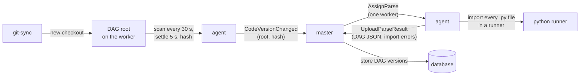

# Parsing and code versions

DAG files are Python. The master has no Python and never runs user code, so it can't read
them. Workers do, and send the master the result as plain data. This page covers how code
gets from a git repository to a DAG the master can schedule, and which code a task runs.

## From files to DAGs

1. **Detect.** Every `[dags] poll_interval` (30 s) the agent scans each root, following
   symbolic links, which is how git-sync switches checkouts. A changed root must then stay
   unchanged for `[dags] settle_time` (5 s), so a half-written checkout is never read.
2. **Hash and copy.** The agent copies the root's files into its own read-only copy (below)
   and hashes every file, not only `.py` files, by path and contents. Every worker with the
   same code gets the same hash. Only a new hash is reported.
3. **Report.** `CodeVersionChanged(root, hash)` goes to the master. Every worker reports on its
   own, but the master creates **one parse job per (root, hash, schedr version)**.
4. **Parse.** One worker that reported the hash gets `AssignParse`. Its parse slot (one per
   worker, separate from task slots) runs a Python runner that imports each `.py` file from
   the copy of that hash. When
   the worker has fork servers, that runner is a fresh child for the job: the preloaded
   server, then the bare one, then a new process. `schedr dags check` starts a new process
   and does not ask the fork servers. The native API only *records* DAGs while a file is
   imported; no task runs. A file that takes longer than `[dags] parse_file_timeout` (60 s)
   is an import error, and so is a runner that died while importing it. Neither holds the
   file's DAGs: the file is parsed again ([Parsed again](#parsed-again)). The runner also
   returns the Python warnings each import raised (a `TypingHint` for an outcome class type
   checkers can't narrow, for example). Only `schedr dags check` shows them; the agent
   doesn't upload them.
5. **Upload.** The agent sends the DAG JSON and the import errors per file.
   The master validates them and stores a new DAG version for each DAG that changed. A new
   DAG is stored **paused**. The upload is a stream: a header, then one message per file, so
   only a single file's size counts against `[master] grpc_max_message_size` (64 MiB by
   default), which the master sends the worker in `Registered`. A file whose parse result is
   bigger is uploaded as its import error, `ParseResultTooLarge`, naming the setting. That,
   a file the master refuses after it imported (`InvalidDag`), and a path that isn't inside
   the root (`InvalidPath`), each hold every DAG of the file. A file that raised while it
   was imported does too
   ([When a file fails to import](#when-a-file-fails-to-import)). The
   upload runs beside the worker's session, so heartbeats go on while it is sent.

A parse job that hasn't finished after 10 minutes, or whose worker is lost, goes to the next
worker that reported the same hash. Parse jobs live only in the master's memory. After a
master restart, workers report their hashes again and the jobs are created again. A
stored parse is parsed again only when a file of it failed transiently
([Parsed again](#parsed-again)).

## When a file fails to import

Each file of a parse is stored on its own, with the worker that parsed it and the time.
The [Import errors](12-ui.md#import-errors) page lists the files of each root's current
code that failed. A warning or a `TypingHint` is not among them.

| What happened | Recorded as | What follows |
|---|---|---|
| The file raised while it was imported | that exception, its message and its traceback | every DAG of the file is [held](#a-held-dag) |
| The import took longer than `parse_file_timeout`, or the runner died | `ParseTimeout` or `RunnerDied` | nothing is held; the file is [parsed again](#parsed-again) |
| The file imported, but a DAG in it fails the master's checks, its path isn't inside the root, or the whole file's parse result is bigger than `grpc_max_message_size` | `InvalidDag`, `InvalidPath` or `ParseResultTooLarge` | every DAG of the file is held, and the file is not parsed again |

A file that failed, for any of these, keeps the DAGs of its last version that imported.
A file that has never imported defines none yet.

### A held DAG

The hold is the file's, so every DAG defined in that file is held while the error is in
the root's current parse. The scheduler creates no run of it. A fire time during the hold
is missed, as while the DAG is paused. A manual trigger is rejected. The reason names the
DAG, the file and the error, and says what to change: for a result that is too large, for
a DAG the checks refuse, for a path outside the root, or, for anything else, that the file
has to import. A queued run is not started. A run that has already started is not
cancelled. The API reports `held`: the reason, the file, the exception and the message, or
nothing when the DAG is not held. `schedr dags list` has a `HELD` column (`yes:` and the
exception, or `no`) and prints each reason under the table. The
[DAG page](12-ui.md#a-dag) shows a held badge, the reason and a Trigger that does not
send. The master logs a warning when the hold starts ("DAG held (its file failed); no run
is created or started until the file is fixed") and a note when the file imports again
("DAG no longer held: its file imports again; missed fire times follow its catchup
setting"). The gauge is `schedr_master_dags{state="held"}`
([Observability](09-observability.md)).

### Parsed again

Only `ParseTimeout` and `RunnerDied` are parsed again, with no limit on the number of
tries. The first retry waits 30 seconds. Each wait after that is twice the last, up to 10
minutes. That wait is separate from a parse job that hasn't finished after 10 minutes,
which is handed to another worker at once. The retry goes to a worker other than the one
whose parse failed, when another worker has reported the same code. The worker that failed
gets it only when it is the only one.

The worker imports the root again. The master replaces only a file that failed transiently
and whose new result differs, and a file the stored parse doesn't have. A file that loaded
keeps its result, and so does a file that fails again in the same way: the worker and the
time stored for it stay. A file the retry does replace records the worker that parsed it
this time, and when.

Parse jobs live only in the master's memory. After a restart, workers report their hashes
again, and a stored parse that still has such a file is planned when a worker reports the
code. The worker avoided is the one stored on the failed file that comes first by path,
when another worker has the code. A file that keeps failing this way never takes effect.
The master logs a warning naming those files, and the import error stays listed.

## Which code runs: only the newest

Workers can report different hashes of a root for a while, as git-sync catches up pod by pod.
schedr keeps no old code, so it runs **only the newest code**:

- The root's **current** hash is the one workers switched to most recently. A switch is a
  worker moving away from the current hash, so a revert counts as new code. A lagging worker
  catching up through older revisions changes nothing. This is kept in the database
  (`root_hashes`), so a restarted master decides the same.
- The current hash's parse defines the root's DAGs.
- The root's tasks go **only to workers at the current hash**, or at a newer one being parsed.
  `AssignTask` carries the expected hash, and a worker whose code moved meanwhile rejects the
  task with `CODE_MISMATCH`, to be tried again shortly.
- A task waiting for code says so ("waiting for workers serving queue `default` to have the
  newest code of root `etl`"). A task that waits longer than `[master] code_wait` (10 min)
  becomes `unschedulable`; `schedr tasks retry` gives it another chance.

What a worker imports, for a parse job and for a task, is **its own copy of the code it
hashed**. When a root settles, the agent copies its scanned files into its data directory
(`code/<worker ID>/…`), hashing the bytes it copies, so the hash is the copy's. Whatever then
happens to the root (git-sync moving its link and deleting the old checkout, or an edit in
place) leaves running jobs alone. So:

- Tracebacks, `__file__` and a Python task's working directory show the copy's path
  (`…/code/w-0/etl-1a2b3c4d/sha256-3f2a…/team/sync.py`), not `/git/current/…`.
- **The copy is read-only.** Attempts of the same code share it, so a task writes its files
  elsewhere (a temporary directory, an output folder). It guards against mistakes, not against
  the task: the code runs as the worker's user, which owns the copy (workers and their DAG code
  are trusted, decision 101).
- **Only the hashed files are in it.** What `.schedrignore` excludes is not, so read such a
  file by its full path under the configured root.
- A copy is removed once newer code replaced it and nothing running uses it: one or two per
  root at a time.

Code under a DAG root is compiled from its source at every import, never taken from a
`.pyc` (Python's own check can miss a change made within a second), and no `.pyc` is written
there.

A run keeps the DAG version it started with, but its tasks run the newest code. If a task or
its file is gone from the newest code, the attempt fails (`task_not_found`,
`dag_file_missing`), and the error says how the DAG changed after the run started. While
workers report different hashes of a root, the master logs a warning. A run whose attempts
ran on different code lists its hashes in the API (`code_hashes`), in the order the run
first used them. The run page warns and lists them when there is more than one (see
[A run](12-ui.md#a-run)).

## Upgrades

The protocol and DAG JSON both carry a `major.minor` version. The master accepts workers and
parses with the same major version and an equal or lower minor, so **upgrade the master
first, then the workers**. A worker of a newer schedr version that reports a hash with only an
older parse gets a parse job. Until that parse is stored, the old one is used. A task goes only
to workers whose schedr version is at least the version of the parse in use, so a rolling
upgrade needs no downtime.

## Conflicts

A DAG ID defined in two places within the current code (two files, or two roots) is in
**conflict**. No new runs are created and nothing is assigned until it is resolved; running
attempts finish. Workers on different code are never a conflict: only the newest code counts.
