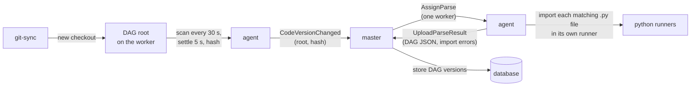

# Parsing and code versions

DAG files are Python. The master has no Python and never runs user code, so it can't read
them. Workers do, and send the master the result as plain data. Script roots contain
`schedr.toml` declarations instead; the agent reads them in Rust. This page covers how code
gets from a git repository to a DAG the master can schedule, and which code a task runs.

## From files to DAGs

1. **Detect.** Every `[dags] poll_interval` (30 s) the agent scans each root, following
   symbolic links, which is how git-sync switches checkouts. A changed root must then stay
   unchanged for `[dags] settle_time` (5 s), so a half-written checkout is never read.
2. **Hash and copy.** The agent copies the root's files into its own read-only copy (below)
   and hashes every file, not only `.py` files, by path and contents. Every worker with the
   same code gets the same hash. Only a new hash is reported.
3. **Report.** `CodeVersionChanged(root, hash)` goes to the master. Every worker reports on its
   own, but the master creates **one parse job per (root, hash, schedr version)**.
4. **Parse.** One worker that reported the hash gets `AssignParse`. Its parse slot (one per
   worker, separate from task slots) imports each `.py` file whose bytes contain `schedr`
   from the copy of that hash, each in a process of its own. Other files are still copied and
   hashed. A file that can't be read or isn't regular is left to the parser to report. If no
   `.py` file qualifies, the worker starts no runner. With fork servers, each runner is a
   fresh child of the preloaded server, then the bare one if needed, falling back to a new
   process; without them it is spawned. `schedr dags check` follows the same choice. The native
   API only *records* DAGs while a file is imported; no task runs. A file that takes longer
   than `[dags] parse_file_timeout` (60 s) is an import error, and so is a runner that died
   while importing it. Neither holds the file's DAGs: the file is parsed again
   ([Parsed again](#parsed-again)). The runner also returns the Python warnings each import
   raised (a `TypingHint` for an outcome class type checkers can't narrow, for example).
   Only `schedr dags check` shows them; the agent doesn't upload them.
5. **Upload.** The agent sends the DAG JSON and the import errors per file.
   The master validates them and stores a new DAG version for each DAG that changed. A new
   DAG is stored **paused**. The upload is a stream: a header, then one message per file, so
   only a single file's size counts against `[grpc] max_message_size` (64 MiB by
   default), which the master sends the worker in `Registered`. A file whose parse result is
   bigger is uploaded as its import error, `ParseResultTooLarge`, naming the setting. That,
   a file the master refuses after it imported (`InvalidDag`), and a path that isn't inside
   the root (`InvalidPath`), each hold every DAG of the file. A file that raised while it
   was imported does too
   ([When a file fails to import](#when-a-file-fails-to-import)). The
   upload runs beside the worker's session, so heartbeats go on while it is sent.

A DAG root's reported hash folds in the content hashes of the other DAG roots on its
`sys.path`: a change in any of them reparses this root too. Workers serving a root must agree
on the roots. With only one DAG root, there is no other DAG root hash to fold in.

A DAG root's reported hash also folds in the hashes of the script roots used by its last
parse. Editing a used script root therefore causes the DAG root to be parsed again; a root
that first starts using a script root is parsed once more. Script and DAG roots with the
same files have different hashes. Each parsed file records the script roots its
`ScriptOperator`s asked for, even when a missing root caused its import to fail. The master
sends each DAG root's used script roots to workers at registration and when the set changes.
A worker missing a used script root warns and withdraws the DAG root: it neither parses it
nor runs its tasks. If no alive worker has reported a script root for five minutes, counted
from the master's start too, the master leaves it out of the sets it sends. This lets a fix
be parsed; a reference to the missing root remains an import error.

Script roots are scanned, settled, copied and hashed like DAG roots. A script root's parse
job reads every `schedr.toml` in Rust on the agent; it never imports scripts or anything else.
A bad file is reported as the import error `InvalidScriptConfig`, with each job-specific
problem prefixed by the job name, for example ``job `report_daily`:``. See [Plain scripts](../02-dags/17-plain-scripts.md).

A parse job that hasn't finished after `[master] parse_job_timeout` (10 minutes by default),
or whose worker is lost, goes to the next
worker that reported the same hash. A worker that connects again gets back the jobs it held,
since a result finished while it was away is dropped; one still running answers instead of a second parse. Parse jobs live only in the master's memory. After a
master restart, workers report their hashes again and the jobs are created again. A
stored parse is parsed again only when a file of it failed transiently
([Parsed again](#parsed-again)).

## Imports and parsing capacity

Files import by ordinary Python names: `team/sync.py` is `team.sync`, and parent packages'
`__init__.py` files run. Dots in file or folder names are refused. A helper's relative
imports resolve in its own package even when the parser imports the helper itself. Each
file's top level runs once per process, so a helper imported by several files can run several
times. A DAG belongs to the file running its `with Dag(...)` block: a helper function can
build a DAG for its caller, while a DAG built at an imported module's top level belongs to
that module. A file defining a DAG must mention `schedr` to be selected for parsing.

A top-level name in two DAG roots, or shared by a DAG root and a library, fails the file
using that name and files importing it; other files and tasks continue. Libraries importing
that name still get the library. A folder of modules without `__init__.py` clashes only with
another root or a namespace library of the same name; an ordinary library wins over it.
Rename a conflicting name or exclude it with `.schedrignore`.

`[dags] parse_concurrency` limits files parsed at once, default 4, capped at the cores the
agent may use; `1` parses one at a time. It also applies to `dags check`. Parsing does not
use task slots, and each process has its own memory budget. With the default two task slots,
four parsers with heavy imports can exceed a pod's memory limit even if none exceeds its own
budget; the kernel may kill the agent. On a tight pod, set `parse_concurrency = 1` or use a
preload list. In stress scenario 22 (12 cores, 1,000 files importing `pydantic`), spawn took
585 s at concurrency 1 and 143 s at 4; fork took 42 s and 14 s. Four at once peaked at
about 60 MiB more than one at a time when spawned, and 20 MiB more when forked; a library
heavier than `pydantic` raises this. On that system a fresh process cost about
0.4 s per file to start parsing, a fork about 5 ms; imports not preloaded still run per file.

## Connections in a parse

A file's parse records the `@connection` definitions made in that file: their names and
values as DAG JSON, with secret names, never secret values. Imported definitions belong to
their own files. Two definitions of one name in a file fail its import; a connection over
1 MiB as JSON does too. See [Connections](../02-dags/14-connections.md).

The master builds a registry for each root from its current parse. A name defined in two
files is refused, with both files named. A file that failed to import contributes no
connections; one that imported but whose DAG the master refused keeps them. Unlike the last
DAG version, connections from a failed import are not kept.

A DAG whose task declares a missing or refused connection still loads, but its
[DAG page](12-ui.md#a-dag) warns which task and connection are affected. The attempt fails
before the task's code runs. `schedr dags check DIR` checks a whole directory's registry and
reports these as errors.

## When a file fails to import

Each file of a parse is stored on its own, with the worker that parsed it and the time.
The [Import errors](12-ui.md#import-errors) page lists the files of each root's current
code that failed. A warning or a `TypingHint` is not among them.

| What happened | Recorded as | What follows |
|---|---|---|
| The file raised while it was imported | that exception, its message and its traceback | every DAG of the file is [held](#a-held-dag) |
| The import took longer than `parse_file_timeout`, or the runner died | `ParseTimeout` or `RunnerDied` | nothing is held; the file is [parsed again](#parsed-again) |
| The file imported, but a DAG in it fails the master's checks, its path isn't inside the root, or the whole file's parse result is bigger than `[grpc] max_message_size` | `InvalidDag`, `InvalidPath` or `ParseResultTooLarge` | every DAG of the file is held, and the file is not parsed again |

A file that failed, for any of these, keeps the DAGs of its last version that imported.
A file that has never imported defines none yet.

### A held DAG

The hold is the file's, so every DAG defined in that file is held while the error is in
the root's current parse. The scheduler creates no run of it. A fire time during the hold
is missed, as while the DAG is paused. A manual trigger is rejected. The reason names the
DAG, the file and the error, and says what to change: for a result that is too large, for
a DAG the checks refuse, for a path outside the root, or, for anything else, that the file
has to import. A queued run is not started. A run that has already started is not
cancelled. The API reports `held`: the reason, the file, the exception and the message, or
nothing when the DAG is not held. `schedr dags list` has a `HELD` column (`yes:` and the
exception, or `no`) and prints each reason under the table. The
[DAG page](12-ui.md#a-dag) shows a held badge, the reason and a Trigger that does not
send. The master logs a warning when the hold starts ("DAG held (its file failed); no run
is created or started until the file is fixed") and a note when the file imports again
("DAG no longer held: its file imports again; missed fire times follow its catchup
setting"). The gauge is `schedr_master_dags{state="held"}`
([Observability](09-observability.md)).

### Parsed again

Only `ParseTimeout` and `RunnerDied` are parsed again, with no limit on the number of
tries. The first retry waits 30 seconds. Each wait after that is twice the last, up to 10
minutes. That wait is separate from a parse job that has passed `[master] parse_job_timeout`,
which is handed to another worker at once. The retry goes to a worker other than the one
whose parse failed, when another worker has reported the same code. The worker that failed
gets it only when it is the only one.

The worker imports the root again. The master replaces only a file that failed transiently
and whose new result differs, and a file the stored parse doesn't have. A file that loaded
keeps its result, and so does a file that fails again in the same way: the worker and the
time stored for it stay. A file the retry does replace records the worker that parsed it
this time, and when.

Parse jobs live only in the master's memory. After a restart, workers report their hashes
again, and a stored parse that still has such a file is planned when a worker reports the
code. The worker avoided is the one stored on the failed file that comes first by path,
when another worker has the code. A file that keeps failing this way never takes effect.
The master logs a warning naming those files, and the import error stays listed.

## Which code runs: only the newest

Workers can report different hashes of a root for a while, as git-sync catches up pod by pod.
schedr keeps no old code, so it runs **only the newest code**:

- The root's **current** hash is the one workers switched to most recently. A switch is a
  worker moving to new code (a hash not seen before) or back to code recorded before the one
  it leaves (a revert, which counts as new code). A worker moving to code recorded later is
  catching up and changes nothing, as does a lagging worker going through older revisions. This is kept in the database
  (`root_hashes`), so a restarted master decides the same. Switches keep the order the master
  saw them in, even if its clock steps back.
- The current hash's parse defines the root's DAGs.
- The root's tasks go **only to workers at the current hash**, or at a newer one being parsed.
  `AssignTask` carries the expected hash, and a worker whose code moved meanwhile rejects the
  task with `CODE_MISMATCH`, to be tried again shortly.
- A task waiting for code says so ("waiting for workers serving queue `default` to have the
  newest code of root `etl`"). A task that waits longer than `[master] code_wait` (10 min)
  becomes `unschedulable`; `schedr tasks retry` gives it another chance.

What a worker imports, for a parse job and for a task, is **its own copy of the code it
hashed**. When a root settles, the agent copies its scanned files into its data directory
(`code/<worker ID>/…`), hashing the bytes it copies, so the hash is the copy's. Whatever then
happens to the root (git-sync moving its link and deleting the old checkout, or an edit in
place) leaves running jobs alone. So:

- Tracebacks, `__file__` and a Python task's working directory show the copy's path
  (`…/code/w-0/etl-1a2b3c4d/sha256-3f2a…/team/sync.py`), not `/git/current/…`.
- **The copy is read-only.** Attempts of the same code share it, so a task writes its files
  elsewhere (a temporary directory, an output folder). It guards against mistakes, not against
  the task: the code runs as the worker's user, which owns the copy (workers and their DAG code
  are trusted, decision 101). Its directories are read-only too, so deleting a worker's data
  directory by hand takes `chmod -R u+w <data_dir>` first.
- **Other DAG roots are on `sys.path` at their copies.** A parse also sees the other DAG
  roots and script roots at their copies. These copies are kept while the parse runs; task
  copies are kept while the task or its recovered cleanup runs.
- **Only the hashed files are in it.** What `.schedrignore` excludes is not shipped to
  parsing or tasks, so read such a file by its full path under the configured root.
  `dags check` uses the same filtered copy, so ignored files cannot be imported there either.
- A copy is removed once newer code replaced it and nothing running uses it: one or two per
  root at a time.

Code under a DAG root is compiled from its source at every import, never taken from a
`.pyc` (Python's own check can miss a change made within a second), and no `.pyc` is written
there.

A run keeps the DAG version it started with, but its tasks run the newest code. If a task or
its file is gone from the newest code, the attempt fails (`task_not_found`,
`dag_file_missing`), and the error says how the DAG changed after the run started. While
workers report different hashes of a root, the master logs a warning. A run whose attempts
ran on different code lists its hashes in the API (`code_hashes`), in the order the run
first used them. The run page warns and lists them when there is more than one (see
[A run](12-ui.md#a-run)).

## Upgrades

The protocol and DAG JSON both carry a `major.minor` version. The master accepts workers and
parses with the same major version and an equal or lower minor, so **upgrade the master
first, then the workers**. A worker of a newer schedr version that reports a hash with only an
older parse gets a parse job. Until that parse is stored, the old one is used. A task goes only
to workers whose schedr version is at least the version of the parse in use, so a rolling
upgrade needs no downtime.

## DAG IDs

A DAG ID is ASCII letters, digits and `_ . - : / #`, at most 250 bytes. It can't be `.` or
`..`: in a URL those mean the current and the parent path, so the API and the UI couldn't
name that DAG. A file defining such a DAG fails to import, and the error says why.

## Conflicts

A DAG ID defined in two places within the current code (two files, or two roots) is in
**conflict**. No new runs are created and nothing is assigned until it is resolved; running
attempts finish, and queued tasks wait, shown as `waiting: DAG ID conflict` (its resources'
cleanups still run). Workers on different code are never a conflict: only the newest code
counts.

A DAG no longer defined (its file deleted, or no longer defining it) is removed: its history is
kept, and its runs in progress finish the attempts they started. Everything else they haven't
started is cancelled at the next round: queued tasks, tasks waiting for upstream ones, retries,
unschedulable tasks, and assignments a worker hasn't started yet (it is told not to); a queued
run ends `cancelled`. A resource's cleanup still runs. A run with a task cancelled this way
ends `cancelled` (or `failed`, if a task failed); one whose tasks had all started ends as they
do. If the DAG comes back, nothing it cancelled starts again.

A conflict is resolved by removing one of the places. If the file left fails to import at
that moment, and the version stored came from the file removed, the DAG stays in conflict
until the file left imports: the removed file's code doesn't come back. The master logs a
warning: `DAG stays in conflict: only one file defines it now, but that file failed to
import...`, with the DAG and the file. Fix the import error (it is shown with the root's
parse) and the DAG takes that file's version.
