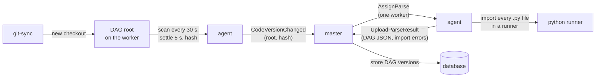

# Parsing and code versions

DAG files are Python. The master has no Python and never runs user code, so it can't read
them. Workers do, and send the master the result as plain data. This page covers how code
gets from a git repository to a DAG the master can schedule, and which code a task runs.

## From files to DAGs

1. **Detect.** Every `[dags] poll_interval` (30 s) the agent scans each root, following
   symbolic links, which is how git-sync switches checkouts. A changed root must then stay
   unchanged for `[dags] settle_time` (5 s), so a half-written checkout is never read.
2. **Hash.** The agent hashes every file of the root, not only `.py` files, by path and
   contents. Every worker with the same code gets the same hash. Only a new hash is reported.
3. **Report.** `CodeVersionChanged(root, hash)` goes to the master. Every worker reports on its
   own, but the master creates **one parse job per (root, hash, schedr version)**.
4. **Parse.** One worker that reported the hash gets `AssignParse`. Its parse slot (one per
   worker, separate from task slots) runs a Python runner that imports each `.py` file. When
   the worker has fork servers, that runner is a fresh child for the job: the preloaded
   server, then the bare one, then a new process. `schedr dags check` starts a new process
   and does not ask the fork servers. The native API only *records* DAGs while a file is
   imported; no task runs. A file that takes longer than `[dags] parse_file_timeout` (60 s)
   is an import error. The runner also returns the Python warnings each import raised (a
   `TypingHint` for an outcome class type checkers can't narrow, for example). Only
   `schedr dags check` shows them; the agent doesn't upload them.
5. **Upload.** The agent sends the DAG JSON and the import errors per file.
   The master validates them and stores a new DAG version for each DAG that changed. A new
   DAG is stored **paused**. The upload is a stream: a header, then one message per file, so
   only a single file's size counts against `[master] grpc_max_message_size` (64 MiB by
   default), which the master sends the worker in `Registered`. A file whose parse result is
   bigger is uploaded as its import error, `ParseResultTooLarge`, naming the setting. The
   upload runs beside the worker's session, so heartbeats go on while it is sent.

A parse job that hasn't finished after 10 minutes, or whose worker is lost, goes to the next
worker that reported the same hash. Parse jobs live only in the master's memory. After a
master restart, workers report their hashes again and the jobs are created again. A parse
that was already stored is not repeated.

## Which code runs: only the newest

Workers can report different hashes of a root for a while, as git-sync catches up pod by pod.
schedr keeps no old code, so it runs **only the newest code**:

- The root's **current** hash is the one workers switched to most recently. A switch is a
  worker moving away from the current hash, so a revert counts as new code. A lagging worker
  catching up through older revisions changes nothing. This is kept in the database
  (`root_hashes`), so a restarted master decides the same.
- The current hash's parse defines the root's DAGs.
- The root's tasks go **only to workers at the current hash**, or at a newer one being parsed.
  `AssignTask` carries the expected hash, and a worker whose code moved meanwhile rejects the
  task with `CODE_MISMATCH`, to be tried again shortly.
- A task waiting for code says so ("waiting for workers serving queue `default` to have the
  newest code of root `etl`"). A task that waits longer than `[master] code_wait` (10 min)
  becomes `unschedulable`; `schedr tasks retry` gives it another chance.

A run keeps the DAG version it started with, but its tasks run the newest code. If a task or
its file is gone from the newest code, the attempt fails (`task_not_found`,
`dag_file_missing`), and the error says how the DAG changed after the run started. While
workers report different hashes of a root, the master logs a warning. A run whose attempts
ran on different code lists its hashes in the API (`code_hashes`), in the order the run
first used them. The run page warns and lists them when there is more than one (see
[A run](12-ui.md#a-run)).

## Upgrades

The protocol and DAG JSON both carry a `major.minor` version. The master accepts workers and
parses with the same major version and an equal or lower minor, so **upgrade the master
first, then the workers**. A worker of a newer schedr version that reports a hash with only an
older parse gets a parse job. Until that parse is stored, the old one is used. A task goes only
to workers whose schedr version is at least the version of the parse in use, so a rolling
upgrade needs no downtime.

## Conflicts

A DAG ID defined in two places within the current code (two files, or two roots) is in
**conflict**. No new runs are created and nothing is assigned until it is resolved; running
attempts finish. Workers on different code are never a conflict: only the newest code counts.
