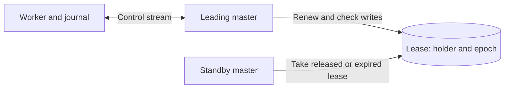

# Guarantees

The master–worker protocol keeps assignments, results and cleanup in order across
reconnects and restarts. This page states its guarantees and limits. The message flows are in
[Master–worker protocol](15-protocol.md). How a worker reads master time, and the races that
reading closes, are in [The master clock](17-master-clock.md). What a stop does to a run is
in [State and failures](07-failures.md#when-something-stops). The numbers below are the
defaults; the settings are in [Timings](14-timings.md#fixed-timings). The inequalities a
change has to keep are in
[Invariants of master time](../_generated/05-design/topics/workers.md#invariants-of-master-time).

## The protocol, and which clock

One master leads, the one that holds the database lease. Standbys wait. Workers keep a
journal on their own disk and open the streams.

The worker also calls `UploadParseResult` and `FetchInputs` on the leader. The standby
refuses worker streams until it leads. The leader renews its lease every 10 s by default.

On `Control` the worker sends `Register`, heartbeats and results; the master sends
assignments, acks and cancels. Every message the master sends carries a `MasterClock`:
`timeline`, `master_ms`, `sequence`, `heard_sequence`, `wall_ms` and `lease_epoch`. Every
message the worker sends carries a `WorkerClock`: its `sequence` and `heard_sequence`.

Each deadline counts on one of these:

| Clock | Kept by | What it sets |
|---|---|---|
| Master time: this process's monotonic clock | The leader | Worker loss, a parse job, a connection job, a moved cleanup's wait, a replaced incarnation's hold, a new leader's wait |
| That same monotonic clock, as a duration from the last renewal | The leader | How long a deposed master still answers |
| The boot clock: its bound of a stamped master time | The worker | The master-time half of the `cleanup_anywhere` cutoff |
| Its own timer | The worker | A stream silent for a lease, the epoch fence, the receipt half of the cutoff |
| The wall clock | The leader | Schedules, set-aside, a sensor's `max_wait`, a resource's `unschedulable_timeout`, the script-root grace |
| Wall clocks compared over a round trip | The worker | The skew warning, for people; it sets no liveness deadline |
| The database clock | The database | When a standby may take the lease |

Each side numbers its messages on a stream, the worker's `Register` being 0. A master
message's `heard_sequence` is the latest worker message the master had received on that
stream; a worker message's is the latest master message the worker had handled. Whether a
worker started an assignment is read from those numbers, not from a clock
([A start, by the echo](#a-start-by-the-echo)). `wall_ms` is there for people. `timeline` is this master process's own;
another master's times are a different timeline. A deadline of the first row is a master
time on that timeline.

## How master time limits a worker

The worker's bound of a master time falls before that master time. That bound is the
worker's side of the limits below. How it is taken from a stamp is in
[The master clock](17-master-clock.md#what-master-time-is).

### A start, by the echo

No assignment has a start deadline. The worker handles master messages in order, and what it
sends while handling an `AssignTask` (`Started`, or `Rejected`) is queued before any later
message that names the assignment as handled.

| When | Master | Worker |
|---|---|---|
| Master message 7 | Sends `AssignTask`. | |
| On it | | Starts the task and sends `Started`, or rejects it. |
| Its next message | | Names 7 as handled. |
| On that message, no `Started` or `Rejected` read before it | Takes the attempt back: it never started, and never will. | |
| No message has named it yet | Leaves the attempt: it may be running. | |

An attempt left that way ends with its worker. The same process registering again takes back
what its journal lacks; a new incarnation's hold ends it `lost` a lease after the
registration (decision 443); a lost worker ends it `lost`, using a retry. The lease must be
at least four heartbeats, 40 s, or the process refuses to start.

### The worker lease, and the cutoff

The master marks a worker lost once master time is past 60 s after the later of two
readings: the last message's arrival, recorded as the bytes are read, and the last message
it has handled. The worker has three limits of its own, and the earliest wins for a
`cleanup_anywhere` task.

| The worker's limit | On | When |
|---|---|---|
| The stream ends, and messages that arrive later are ignored | its own timer | 60 s after the last master message, or after the stream opened |
| The master-time cutoff | its bound | the last stamp's `master_ms` plus 60 s |
| The heard-message cutoff | its bound | 60 s less 0.1 % after it sent the last message the stamp says the master received |

At the earliest of the three limits, the worker begins stopping a `cleanup_anywhere`
task. It sends SIGTERM, then SIGKILL after the cancel grace if needed. Its cleanup waits. The
master holds the worker until 60 s of master time after its last message, and a round past
that marks it lost. It heard that heartbeat no earlier than it was sent, so stopping begins
before the loss. The move wait leaves time for the process group to stop.

The master-time bound keeps a message held on its way from moving the cutoff later
just because it arrived late. A reconnect keeps the previous cutoff until the new
session has a usable stamped sample. A worker with no `cleanup_anywhere` task does
not arm this cutoff. An ordinary task keeps
running after the stream ends.

### A moved cleanup's wait

The wait starts when a round marks the worker lost. It is the cancel grace plus the cleanup
move wait, 30 s + 10 s.

| When, on master time | Master | Worker |
|---|---|---|
| The round that marks the worker lost | Marks it lost. | It has begun stopping its `cleanup_anywhere` tasks, whatever the master sent since. |
| For the next 40 s | Leaves the cleanup where it is. | |
| A round past those 40 s | May assign the cleanup to another worker. | |
| After a restart | Waits a whole 40 s from when this master first sees the cleanup. | |

A cut one way, the worker's messages lost while the master's still arrive, is covered by the
third limit: each master message names the last heartbeat it heard
([A worker cut off one way](17-master-clock.md#a-worker-cut-off-one-way-decision-453)).

### A replaced incarnation's hold

A new incarnation can register once the old stream is no longer live; a duplicate live
stream for the same worker ID is refused. Registration then need not wait for the old
lease to expire. The old stream gets no further heartbeat answers, so its heartbeats do
not extend the hold.

| When | Master | Old process | New incarnation |
|---|---|---|---|
| 0 s of master time | Marks the started attempts the new journal does not report. | | Sends `Register`. |
| By its bound of its last stamp plus 60 s | | It begins stopping its `cleanup_anywhere` tasks. That stamp is at or before the mark. | |
| 60 s of master time after the mark | Ends those attempts lost. | An ordinary task can still be running. | |
| After a restart | Keeps the mark, and counts the 60 s from when this master first sees the attempt. | | |

When the assigned worker reports the attempt in its journal, the master clears the mark.
An attempt allowed to continue is therefore not ended when the hold runs out.

### A new leader's wait, and the lease epoch

Each process below counts on its own clock. The durations are the same settings: the lead
is the master lease minus a query timeout, 30 s − 10 s = 20 s, and it has to be shorter than
the 60 s worker lease or the process refuses to start.

| When | Deposed master | New leader | Worker |
|---|---|---|---|
| Until its last renewal plus 20 s, on its monotonic clock | Answers heartbeats. A clean stop answers nothing more, and gives the lease up. | | |
| From the restore, on its master time | | Counts a worker it has not heard from as heard 20 s ahead. | |
| Until 80 s of master time from the restore | | Holds that worker. | |
| A round past those 80 s | | Marks the worker lost if still unheard. | |
| While the highest lease epoch has been silent under 60 s, on its own timer | | | Refuses a lower epoch. |
| At 60 s of that silence | | | Follows the lower epoch. |

The process refuses to start when that 20 s lead is at least the 60 s worker lease, so the
time a deposed master may still answer is shorter than the time a worker keeps the higher
epoch. The new leader starts the worker lease only after its own 20 s, and marks the worker
lost only after the 60 s that follow. Writes are a different fence: the database refuses a
write once the lease row is another holder's, or the same holder's at a newer epoch.

## The guarantees

### Starting

| Guarantee | What it rests on | Where it stops |
|---|---|---|
| A task is not started after the master took the attempt back | The master takes an unstarted attempt back only once a worker message names its assignment as handled with no `Started` before it, or the same process's journal lacks it. What the worker sends while handling a message comes before anything naming it, on one ordered stream. Otherwise the attempt stays until it ends with its worker. | An attempt that may have started ends `lost` with its worker, using a retry, though it may never have run. |

The message numbers are in
[A start, by the echo](#a-start-by-the-echo) and in
[Message numbers and their echo](17-master-clock.md#message-numbers-and-their-echo-b240).

### One leader

| Guarantee | What it rests on | Where it stops |
|---|---|---|
| One master leads at a time | The lease row names the holder. A standby takes it when it is released, or when the database clock says it has expired. The leader renews every 10 s and answers workers while its monotonic lead, 20 s from the last renewal, still has time. | A deposed master answers heartbeats until that 20 s runs out. A clean stop stops at once. |
| A deposed master's writes are refused | Each write checks the holder and the epoch in the write's transaction, and is refused once the row has moved on. | The lease row expires on the database's clock. A step of that clock can hand the lease over while the old process still has lead left; its writes then fail the check. |

The lease itself is in
[One master per database](04-master.md#one-master-per-database-the-lease). The 20 s wait and
the epoch fence are in the table
[above](#a-new-leaders-wait-and-the-lease-epoch).

### A result

| Guarantee | What it rests on | Where it stops |
|---|---|---|
| A result is delivered at least once | The worker journals the result before it sends `Finished`, and sends it again until `FinishedAck`. After eight resends it reconnects, and the journal is reconciled. | A result not yet acknowledged stays in the journal across an agent restart. Losing that disk loses it. If a journal write fails, the worker logs a warning and keeps the result in memory; a restart before acknowledgement can then lose it. |
| A result is stored once | The end is recorded only while the attempt has no status yet. A second `Finished` is acknowledged, and the stored end stands. | A `Finished` from a worker that does not own the attempt is acknowledged and ignored, except for a cleanup result the master still expects from that worker (a moved cleanup or `CLEAN_REST`). A result the database refuses is stored as the failure `result_not_stored`, and is not retried. |

Repeats are in [Delivery](07-failures.md#delivery). The refused result is in
[When something stops](07-failures.md#when-something-stops).

### Silence, and a cleanup that moves

| Guarantee | What it rests on | Where it stops |
|---|---|---|
| A stream silent for a lease ends | 60 s after the master's last message, on the worker's timer, the worker ends the stream and ignores what arrives later. A `Registered` at least that old on the first stream is ignored, and the worker registers again. | An ordinary task keeps running. A `cleanup_anywhere` task begins stopping here, or sooner, at the cutoff below. |
| A `cleanup_anywhere` cleanup starts only while it is its worker's | Each try's process waits at a barrier (`schedr task-exec`) before running anything. The worker asks the master (`CleanupStart`) only once it waits, and lets it through on `go`, given while the attempt is open and the cleanup this worker's. The process waits at most half the worker lease, counted from before the question. The master moves a cleanup only once it lost the worker, a lease after its last message, and 40 s later: a `go`, however late, finds the process waiting while nothing has moved, or gone (B255, decision 504). | A cleanup let through keeps running and can overlap a move made a lease and 40 s later. A frozen VM: the process's wait may not count the pause. A 1.1.0 worker (protocol 2.1) starts without a barrier. |
| A `cleanup_anywhere` cleanup runs at least once | A cleanup let through is still moved once its worker is lost, after the lease and the 40 s: the worker may have died as it started (decision 528). | It may then run twice, overlapping: the first worker frozen, not dead, its cleanup let through and still running. A cleanup's work should be safe to repeat. |
| A `cleanup_anywhere` task stops before its cleanup moves | The worker begins stopping the task at the earliest of 60 s after the last message received, the bound of the last stamp plus 60 s, and 60 s less 0.1 % after it sent the last message the master says it received. The master loses the worker only once master time is past 60 s after the worker's last message it received, then waits 40 s before the cleanup can move. That covers the 30 s cancel grace and 10 s move wait, including a one-way cut. | A cleanup already running when the cut starts keeps running. A frozen VM does not stop. |

The cutoff and move wait are in the tables under
[The worker lease, and the cutoff](#the-worker-lease-and-the-cutoff) and
[A moved cleanup's wait](#a-moved-cleanups-wait). A cleanup already running, and a frozen VM,
are in [Cleanup on another worker](../02-dags/15-cleanup.md#cleanup-on-another-worker).

### Clocks

| Guarantee | What it rests on | Where it stops |
|---|---|---|
| A wall-clock jump moves no liveness deadline | Worker loss, a parse job, a connection job and a moved cleanup's wait count on master time. The worker reads that time from `MasterClock`. | A jump of the master's monotonic clock is not caught. Five decisions still read the wall clock: schedules, set-aside, a sensor's `max_wait`, a resource's `unschedulable_timeout`, and the script-root grace. A jump can fire one of those early, or hold it. |

Why these decisions stay on the wall clock is in
[One clock, and what still uses the wall clock](17-master-clock.md#one-clock-and-what-still-uses-the-wall-clock).

## What is not guaranteed

Each line is a limit that is kept on purpose, or open for now.

- An assignment its worker may have started, never reported before the worker was lost, ends `lost` using a retry, though it may never have run ([Known limits](17-master-clock.md#known-limits)).
- A cleanup already running at the cut, and a task on a frozen VM, can overlap the moved cleanup ([Cleanup on another worker](../02-dags/15-cleanup.md#cleanup-on-another-worker)).
- After a suspend, the cutoff is read again on the alive tick, every 5 s, so stopping a `cleanup_anywhere` task can begin up to 5 s late, followed by its cancel grace ([Known limits](17-master-clock.md#known-limits)).
- A stall under 1 s, plus 0.2 % of the time since the sample, leaves the worker's bound late by that much ([Known limits](17-master-clock.md#known-limits)).
- The cutoff the last session computed stands over a reconnect, until the new session has a usable stamped sample ([Known limits](17-master-clock.md#known-limits)).
- An ordinary task keeps running after the stream ends, and can overlap its retry once the worker is lost or a replaced incarnation's 60 s hold ends ([When something stops](07-failures.md#when-something-stops)).
- A jump of the master's monotonic clock is not caught ([Known limits](17-master-clock.md#known-limits)).
- Schedules, set-aside, a sensor's `max_wait`, a resource's `unschedulable_timeout` and the script-root grace move with the wall clock ([One clock](17-master-clock.md#one-clock-and-what-still-uses-the-wall-clock)).
- The lease row expires on the database's clock ([One master per database](04-master.md#one-master-per-database-the-lease)).
